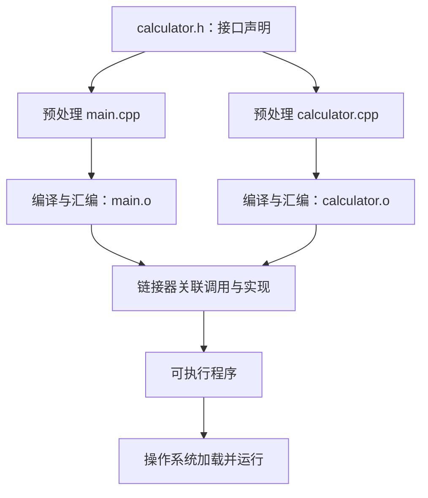
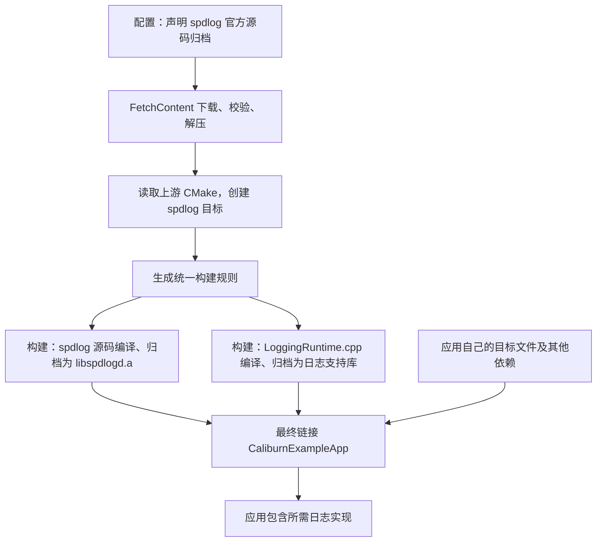
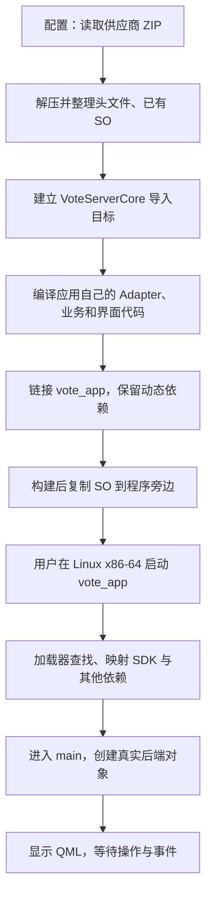
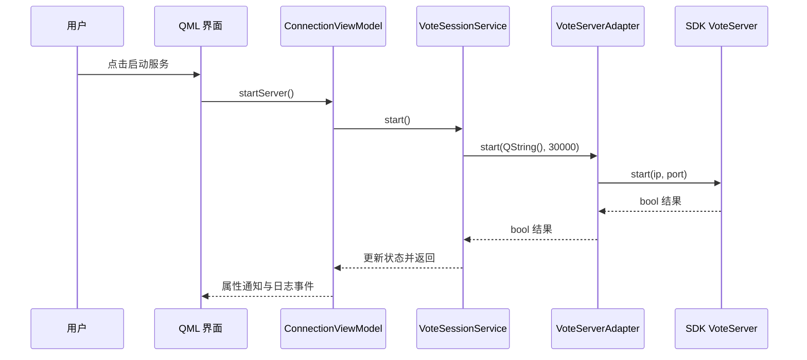
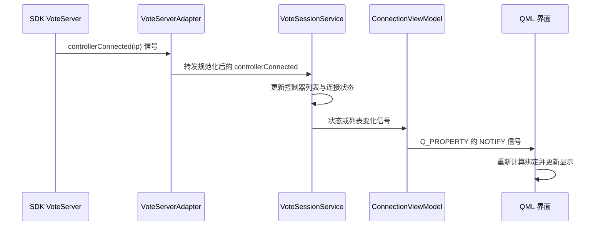

# C++ 静态库与动态库——基础知识与项目实战

本文面向 C++ 初学者，从“一个函数怎样变成可运行代码”开始，解释静态库、动态库、头文件、编译、链接和加载之间的关系，再结合两个真实项目走完执行流程。

阅读顺序建议：先读第 1～5 节建立基础，再动手运行第 7 节的小例子，最后对照第 8、9 节查看项目代码。第 6 节解释 CMake，遇到陌生配置时可以回查。

配套阅读：[如何在 Qt 项目中使用第三方库——入门级教程](如何在Qt项目中使用第三方库-入门级教程.md)。那篇侧重依赖获取；本文侧重获取之后，代码怎样编译、链接并运行。

项目核对日期：2026-10-12。案例来自当时本机工作区：

| 案例 | 本机目录 | 主要观察对象 |
|---|---|---|
| Caliburn.Micro.Qt | `/Users/guhui/Githubs/caliburn-micro-qt` | spdlog v1.17.0 静态库、Boost.DI v1.3.2 头文件库 |
| 表决设备应用 | `/Users/guhui/GitLabs/project_expo/vote_device` | 供应商 `libVoteServerCore.so` 动态库 |

文中的项目源码链接使用上述本机绝对路径；在其他机器阅读时，请按仓库中的相对位置查找。标有“示意”的目录、输出和代码用于解释机制，不冒充实机输出。真实项目节选会注明省略内容。

## 1. 从一个函数到可执行程序

### 1.1 声明：告诉编译器怎样使用

假设我们提供一个加法函数。头文件中的声明是：

```cpp
int add(int a, int b);
```

这行代码说明：

- 函数名是 `add`。
- 接受两个 `int` 参数。
- 返回一个 `int`。

编译器看到声明，就能检查 `add(2, 3)` 的写法是否正确。声明没有说明怎样计算结果。

### 1.2 定义：提供实际实现

源文件中可以定义：

```cpp
int add(int a, int b)
{
    return a + b;
}
```

函数体提供了实现。常见项目会把接口声明放进 `.h` 或 `.hpp`，把普通函数实现放进 `.cpp`，让不同源文件共用同一套接口。

这是一种常用组织方式，并非扩展名强制的语言规则。头文件也能包含类定义、模板、内联函数及其他实现。后面的 Boost.DI 就属于实现放在头文件中的情况。

### 1.3 预处理、编译、汇编、链接、加载

以 `main.cpp` 调用 `calculator.cpp` 中的函数为例：



| 阶段 | 主要工作 | 初学时可以怎样理解 |
|---|---|---|
| 预处理 | 展开 `#include`、处理宏和条件编译 | 准备实际交给编译器的代码 |
| 编译 | 检查代码并生成低层表示或汇编 | 把 C++ 转成机器能执行的形式 |
| 汇编 | 生成机器指令和相关信息 | 形成 `.o` / `.obj` 目标文件 |
| 归档 | 把多个目标文件收进静态库 | 形成 `.a` / 静态 `.lib` |
| 链接 | 关联符号、安排代码与数据 | 生成可执行文件或动态库 |
| 加载 | 将程序及必要动态库映射到进程 | 为实际执行做好准备 |

工具可以把几个阶段合并在一次命令中。日常说“编译项目”，也经常把整个构建过程统称为编译；排错时需要把阶段重新分开。

### 1.4 目标文件是什么

macOS、Linux 常见 `.o`，Windows 常见 `.obj`。目标文件通常包含机器代码、数据、符号和重定位信息，通常不能作为普通应用直接运行。

“符号”可以先理解为二进制文件中用于标识函数或变量的名称。“重定位”则涉及在链接、加载时调整地址。

示意：

```text
main.o
├── 已有：main 的实现
└── 尚需关联：add 的实现

calculator.o
└── 已有：add 的实现
```

`main.cpp` 编译时知道函数声明即可；链接时再找到对应实现。只有声明而没有链接到实现，就可能出现 `undefined reference` 或 `undefined symbol`。

## 2. 静态库：在链接阶段纳入实现

### 2.1 `.a` 是目标文件归档

假设一个计算库有四个源文件：

```text
add.cpp       → add.o
subtract.cpp  → subtract.o
multiply.cpp  → multiply.o
divide.cpp    → divide.o
```

可以将它们归档成一个静态库：

```text
libcalculator.a
├── add.o
├── subtract.o
├── multiply.o
└── divide.o
```

这里的“打包”主要表示归档，不表示像 ZIP 一样压缩。Windows 使用 MSVC 时，类似产物通常叫 `calculator.lib`。

### 2.2 链接器怎样使用静态库

应用链接时，将自己的目标文件和静态库交给链接器：

```text
main.o + libcalculator.a
            ↓ 链接
           app
```

链接器根据尚未满足的引用，从静态库选取需要的目标文件。后续优化还可能移除未使用的代码。通常不会无条件把库中所有功能全部放进程序；特殊链接选项可以改变这种行为。

最终程序中已经包含所需实现：

```text
app
├── 应用自己的机器代码
└── 从计算库纳入的机器代码
```

运行 `app` 时，不需要再读取 `libcalculator.a`。静态库文件的主要使用时机是构建阶段。

### 2.3 更新静态库会影响已有程序吗

假设 `app` 已经发布。后来你修复 `calculator.cpp`，生成了新的 `.a`，旧的 `app` 仍然包含旧实现。

要发布修复，需要重新链接生成应用并重新分发；如果头文件也变了，还可能需要重新编译相关源文件。

多个应用静态链接同一个库时，各自的链接产物通常会包含各自所需的实现。因此静态链接可能增加整体分发体积，但减少对应库的运行时部署步骤。

### 2.4 静态库可以依赖另一个库

例如本项目案例中的：

```text
应用 → 日志支持静态库 → spdlog 静态库
```

创建日志支持 `.a` 时，通常只归档日志支持库自己的目标文件，并不会自动把另一个 `.a` 全部塞进去。最终链接应用时，还要带上 spdlog。CMake 可以记录并传递这种依赖，详见第 6.4 节。

一个静态库也可以在源码中调用动态库的方法。静态与动态描述具体库和链接方式，整个应用可以混合使用两者。

## 3. 动态库：保留独立文件，由加载器关联

### 3.1 常见扩展名

| 平台 | 目标文件 | 静态库常见形式 | 动态库常见形式 |
|---|---|---|---|
| Linux | `.o` | `libcalculator.a` | `libcalculator.so` |
| macOS | `.o` | `libcalculator.a` | `libcalculator.dylib` |
| Windows / MSVC | `.obj` | `calculator.lib` | `calculator.dll`，通常配有导入 `.lib` |

扩展名是常见约定，不足以单独判断兼容性。例如 macOS 的部分模块也使用 `.so` 后缀，但 Linux ELF 文件不能因此直接在 macOS 使用。还要看二进制格式、CPU 架构和依赖。

### 3.2 启动时自动加载

应用在构建时链接动态库，生成的可执行文件保留所需动态依赖。运行时由加载器查找库、映射代码和数据，并建立必要的地址关联。

```text
构建阶段：main.o + 动态库的链接信息 → app

运行阶段：app + 独立动态库 → 正在运行的进程
```

对于普通的启动依赖，必要动态库在进入应用的 `main()` 前就需要准备好。具体函数地址解析可以是立即完成，也可以部分延迟到首次调用，取决于平台和链接、加载设置。

程序中的调用看起来仍是普通 C++ 调用：

```cpp
int result = add(2, 3);
```

应用不必每次写出库路径，也不必每调用一次就重新加载。加载器负责关联到实际代码。Linux/glibc 的加载职责见 [Dynamic Linker](https://sourceware.org/glibc/manual/latest/html_node/Dynamic-Linker.html)。

### 3.3 运行中主动加载

另一种方式是程序运行后按需要主动加载库，查找某个导出函数，再通过函数指针调用。

| 平台或框架 | 常见加载与符号查找接口 |
|---|---|
| Linux | `dlopen`、`dlsym` |
| Windows | `LoadLibraryEx`、`GetProcAddress` |
| Qt | `QLibrary::load`、`QLibrary::resolve` |

它适合插件或可选功能。开发者需要处理加载失败、接口签名、对象寿命及卸载时机。Qt 也提供更适合 Qt 插件接口的 `QPluginLoader`。

启动时自动加载和运行中主动加载，都属于使用动态库。当前表决项目采用前一种方式。Windows 的两种方式见 [Microsoft：链接可执行文件到 DLL](https://learn.microsoft.com/en-us/cpp/build/linking-an-executable-to-a-dll?view=msvc-170)，Qt 接口见 [QLibrary](https://doc.qt.io/qt-6.8/qlibrary.html)。

### 3.4 动态库运行在谁的进程里

普通动态库被加载进调用它的进程地址空间。调用 `.so` 中的方法，通常就是当前进程执行该方法的机器代码。

例如 `vote_app` 调用供应商方法，不代表自动启动一个独立“SDK 服务进程”，也不代表通过网络远程调用这个库。SDK 的方法本身可以再进行网络通信，这属于该方法的业务实现。

多个进程可以使用同一份动态库文件，操作系统可以共享其中适合共享的只读代码页。各进程通常仍有独立的可写数据、对象和全局变量。跨进程共享状态需要额外机制。

### 3.5 加载、对象、方法和服务是四层概念

| 动作 | 发生什么 | 表决项目中的例子 |
|---|---|---|
| 加载库 | 准备动态库的代码与数据 | 启动时加载 `libVoteServerCore.so` |
| 创建对象 | 分配实例并执行构造函数 | 创建 `VoteServerCore::VoteServer` |
| 调用方法 | 执行对象对应的函数代码 | 调用 `start()` 或 `stop()` |
| 启动业务服务 | 方法执行实际业务 | 开始监听 TCP 30000 |

`stop()` 停止业务服务，不意味着卸载动态库。对象析构也不等于库文件立即卸载。进程结束后，操作系统回收该进程的资源。

## 4. 两种库的区别与选择

| 比较项 | 静态库 | 动态库 |
|---|---|---|
| 实现的位置 | 所需实现纳入最终链接产物 | 保留在独立动态库中 |
| 对应库文件何时使用 | 主要在构建时 | 链接时可能使用，运行时也需要 |
| 应用可执行文件体积 | 通常较大 | 通常较小，但要计入库文件 |
| 发布部署 | 无需分发对应 `.a` / 静态 `.lib` | 必须提供兼容库或依赖兼容系统库 |
| 更新库实现 | 通常重新链接和发布应用 | 二进制兼容时可替换库文件 |
| 多个应用复用 | 各自携带所需实现 | 可复用库文件及部分内存代码页 |
| 插件与可选功能 | 较少用于运行时独立插件 | 常用于运行时插件 |

不能只根据“静态”或“动态”断定谁运行更快。优化方式、跨库边界、加载开销和实际工作负载都会影响结果，性能判断需要测量。

对于当前两个案例，选择依据很具体：spdlog 较小且由应用统一构建，静态使用便于部署；表决 SDK 由供应商以 Linux `.so` 提供，项目按其发布形式接入。

### 4.1 ABI：替换动态库为什么有条件

API 是源码层面的接口，例如 `bool start(const QString &, quint16)`。ABI 是已经编译后的代码如何相互协作的约定，涉及符号名称、参数传递、对象布局等。

两个文件即使都叫 `libVoteServerCore.so`，也可能不兼容。例如它们使用不同架构、不兼容的类布局或不满足的运行库版本。

当库对外暴露 C++ 类、Qt 类型和容器时，需要特别核对供应商支持的编译与运行环境。`extern "C"` 可以避免 C++ 函数名编码的一些问题，但不能自动解决所有 ABI 兼容问题。

“替换 DLL/SO 即可升级”应理解为：在二进制接口和行为满足应用要求的前提下，独立替换可以成立。

## 5. 常见误解

### 5.1 动态库是否必须注册和系统安装

普通动态库通常无需注册。需要让加载器按正确路径找到兼容文件，并满足它的依赖。

| 术语 | 含义 |
|---|---|
| 注册 | 向某种组件机制登记信息，例如部分 Windows COM 组件 |
| 安装 / 部署 | 将文件放入适当目录，安排搜索路径与依赖 |
| 加载 | 将库映射进进程并进行初始化、地址关联 |

动态库可以随应用放置，也可以通过包管理器安装到系统目录。安装到系统目录只是部署方案之一。Linux 的 `ldconfig` 管理共享库缓存等信息，也不等于每个应用私有 `.so` 都必须执行一次注册。

### 5.2 Windows 的 `.lib` 有两种常见含义

| 类型 | 主要作用 | 是否还需要对应 DLL |
|---|---|---|
| 静态 `.lib` | 提供纳入链接产物的目标代码 | 这部分实现不需要对应 DLL |
| 导入 `.lib` | 为链接器提供 DLL 的导入信息 | 需要 |

导入库不是 DLL 全部实现的副本。它让链接器知道函数来自哪个 DLL，并建立调用所需的信息。

因此一个 Windows SDK 同时提供 `.h`、`.lib`、`.dll` 很常见：头文件供编译，导入库供链接，DLL 供运行。不能看到 `.lib` 就断定静态链接。参考 [Microsoft 静态库教程](https://learn.microsoft.com/en-us/cpp/build/walkthrough-creating-and-using-a-static-library-cpp?view=msvc-170) 与前文 DLL 链接说明。

### 5.3 能找到头文件，为什么还会报错

头文件搜索与库链接是两项不同配置。头文件让编译器知道接口，库或其他目标文件提供外部实现。

| 现象 | 主要排查阶段 |
|---|---|
| `xxx.h file not found` | 编译器的头文件搜索目录 |
| `undefined reference` / `Undefined symbols` | 链接是否包含正确实现 |
| 找不到 `.so` / `.dll` / `.dylib` | 运行时库搜索和部署 |
| SDK `start()` 返回失败 | 已进入方法调用，检查业务条件和 SDK 错误 |

### 5.4 链接了静态库，是否整个应用都静态

不一定。应用可以静态链接 spdlog，同时动态链接 Qt 和系统运行库。部署时仍需满足其他动态依赖。

### 5.5 把 `.so` 改成 `.dylib` 能跨平台吗

改扩展名不会转换机器代码和二进制格式。Linux ELF x86-64 供应商库要在 Mac arm64 使用，需要供应商提供相应平台版本，或拥有可移植源码后重新构建。

## 6. CMake 怎样关联源码、头文件和库

### 6.1 CMake、构建工具与编译器

| 工具 | 职责 |
|---|---|
| CMake | 读取配置，建立目标及依赖，生成构建规则 |
| Ninja / Make / MSBuild | 按规则调度任务，进行增量构建 |
| Clang / GCC / MSVC | 编译 C++ 源码 |
| 归档工具和链接器 | 形成静态库、动态库、可执行文件 |

`cmake -S . -B build` 主要配置并生成规则；`cmake --build build` 调用构建工具。配置中可能执行编译器检测，但不会因此等于已经完成所有业务源码的编译。

### 6.2 目标不是单纯的文件路径

CMake 目标可以同时携带源码、产物位置、头文件目录、编译宏和链接依赖：

```text
目标 calculator
├── 源码：calculator.cpp
├── 产物：静态库或动态库
├── 头文件目录：当前源码目录
└── 其他使用要求
```

常见目标定义：

```cmake
# 三组独立示意，展示不同目标类型。
add_library(CalculatorStatic STATIC calculator.cpp)
add_library(CalculatorShared SHARED calculator.cpp)
add_library(CalculatorHeaders INTERFACE)
```

| 类型或标记 | 含义 |
|---|---|
| `STATIC` | 由当前工程构建静态库 |
| `SHARED` | 由当前工程构建动态库 |
| `IMPORTED` | 描述一个已经存在的外部库，不负责构建它 |
| `INTERFACE` | 传递使用要求，本身不产生普通库文件 |
| `ALIAS` | 给已有目标一个别名 |

例如 `add_library(Calculator::Core ALIAS CalculatorStatic)` 不会再编译一份库。`Calculator::Core` 是 CMake 名称，与 C++ 命名空间是不同概念。参考 [CMake add_library](https://cmake.org/cmake/help/v3.21/command/add_library.html)。

### 6.3 头文件搜索路径和使用要求

```cmake
target_include_directories(CalculatorStatic PUBLIC
    "${CMAKE_CURRENT_SOURCE_DIR}/include"
)

target_link_libraries(app PRIVATE CalculatorStatic)
```

`CalculatorStatic` 公开头文件目录，`app` 使用该目标后接收到相应要求。编译器获得 `-I目录`，或系统头目录对应的 `-isystem 目录` 等参数。

```text
搜索目录：某目录/include
源代码：  #include <calculator/calculator.h>
实际查找：某目录/include/calculator/calculator.h
```

`SYSTEM` 表示按系统头文件方式处理，常用于降低第三方头文件警告。它不会把文件复制进系统目录。参考 [target_include_directories](https://cmake.org/cmake/help/v3.21/command/target_include_directories.html)。

使用目标而非硬编码库文件，可以一并接收头文件、编译宏、链接依赖和构建顺序等信息。仅调用 `add_dependencies` 安排顺序，不等于已经完成头文件与链接配置。

### 6.4 PRIVATE、PUBLIC、INTERFACE 与静态库依赖

对头文件目录等编译使用要求，可以这样理解：

| 关键字 | 当前目标使用 | 向使用当前目标的消费者传递 |
|---|---|---|
| `PRIVATE` | 是 | 否 |
| `PUBLIC` | 是 | 是 |
| `INTERFACE` | 否 | 是 |

如果公开头文件包含某个第三方头文件或暴露相关类型，消费者通常也需要其编译要求；如果仅 `.cpp` 使用第三方实现，可以作为私有依赖。

静态库需要进一步区分“编译要求”和“最终链接依赖”：

```cmake
add_library(wrapper STATIC wrapper.cpp)
target_link_libraries(wrapper PRIVATE SomeLibrary)
target_link_libraries(app PRIVATE wrapper)
```

在现代 CMake 的这类目标关系中，`app` 编译自己的代码不必继承 `SomeLibrary` 的头文件目录和宏，但最终链接仍需要满足 `wrapper` 对它的引用。CMake 会保留必要的链接依赖。

因此 `PRIVATE` 既不表示把依赖嵌入静态库，也不表示最终程序无需链接它。`INTERFACE` 目标则主要传递要求，使用 `target_link_libraries` 接收它，不一定产生真实的库链接动作。参考 [target_link_libraries](https://cmake.org/cmake/help/v3.21/command/target_link_libraries.html)。

## 7. 动手：用同一份源码构建静态与动态版本

本例不依赖 Qt 和网络。建立一个新的临时示例目录，按下面四个文件保存代码。示例源码仅放在本文中，不添加到学习仓库的构建目标。

```text
示例目录/
├── CMakeLists.txt
├── calculator.h
├── calculator.cpp
└── main.cpp
```

### 7.1 CMakeLists.txt

```cmake
cmake_minimum_required(VERSION 3.21)
project(LibraryBasics LANGUAGES CXX)

set(CMAKE_CXX_STANDARD 17)
set(CMAKE_CXX_STANDARD_REQUIRED ON)
set(CMAKE_CXX_EXTENSIONS OFF)

option(BUILD_SHARED_LIBS "构建动态计算库" OFF)

# 不显式写 STATIC / SHARED，由 BUILD_SHARED_LIBS 决定。
add_library(calculator calculator.cpp)
add_library(Calculator::Core ALIAS calculator)

# 生成跨平台的导出/导入宏头文件，兼顾 Windows DLL。
include(GenerateExportHeader)
file(MAKE_DIRECTORY "${CMAKE_CURRENT_BINARY_DIR}/generated")
generate_export_header(calculator
    EXPORT_FILE_NAME "${CMAKE_CURRENT_BINARY_DIR}/generated/calculator_export.h"
)
if(NOT BUILD_SHARED_LIBS)
    target_compile_definitions(calculator PUBLIC CALCULATOR_STATIC_DEFINE)
endif()

target_include_directories(calculator PUBLIC
    "${CMAKE_CURRENT_SOURCE_DIR}"
    "${CMAKE_CURRENT_BINARY_DIR}/generated"
)
set_target_properties(calculator PROPERTIES
    CXX_VISIBILITY_PRESET hidden
    VISIBILITY_INLINES_HIDDEN YES
)

add_executable(library_demo main.cpp)
target_link_libraries(library_demo PRIVATE Calculator::Core)
```

### 7.2 calculator.h

```cpp
#pragma once

#include "calculator_export.h"

CALCULATOR_EXPORT int add(int a, int b);
```

`calculator_export.h` 由配置阶段自动生成，不需要手写。宏让库公开 `add`，在 Windows 上还区分构建 DLL 的导出与使用 DLL 的导入。静态构建使用相应静态定义。参考 [GenerateExportHeader](https://cmake.org/cmake/help/v3.21/module/GenerateExportHeader.html)。

### 7.3 calculator.cpp

```cpp
#include "calculator.h"

int add(int a, int b)
{
    return a + b;
}
```

### 7.4 main.cpp

```cpp
#include "calculator.h"

#include <iostream>

int main()
{
    std::cout << add(2, 3) << '\n';
    return 0;
}
```

### 7.5 在 Apple Silicon macOS 构建

从保存了上述文件的示例目录执行。需要 CMake、Ninja 和可用的本机 C++ 工具链。

```sh
# 静态版本
cmake -S . -B build-static -G Ninja \
  -DCMAKE_BUILD_TYPE=Debug \
  -DCMAKE_OSX_ARCHITECTURES=arm64 \
  -DBUILD_SHARED_LIBS=OFF
cmake --build build-static --verbose
file build-static/library_demo
./build-static/library_demo

# 动态版本
cmake -S . -B build-shared -G Ninja \
  -DCMAKE_BUILD_TYPE=Debug \
  -DCMAKE_OSX_ARCHITECTURES=arm64 \
  -DBUILD_SHARED_LIBS=ON
cmake --build build-shared --verbose
file build-shared/library_demo
./build-shared/library_demo
```

两次运行都应输出 `5`，但产物与运行依赖不同：

| 构建目录 | 库产物 | 程序运行时是否需要这个计算库文件 |
|---|---|---|
| `build-static` | `libcalculator.a` | 不需要 |
| `build-shared` | `libcalculator.dylib` | 需要 |

CMake 会为构建目录安排运行路径，使动态示例能在该构建目录运行。这不等于已经完成移动到任意机器的正式部署。

### 7.6 观察结果

macOS 上执行：

```sh
ar -t build-static/libcalculator.a
otool -L build-static/library_demo
otool -L build-shared/library_demo
otool -l build-shared/library_demo
```

- `ar -t` 查看静态库包含的归档成员。
- `otool -L` 查看动态依赖：动态版本应出现计算动态库，静态版本不会依赖它。
- `otool -l` 可以查看包含 `LC_RPATH` 的加载命令。
- 静态版本仍可能列出 `libc++`、`libSystem` 等系统库，这与静态使用计算库并不矛盾。

Linux 可使用相同源码，配置时省略 `CMAKE_OSX_ARCHITECTURES`，并改用 `ldd`、`readelf` 观察 `.so`。Windows 可用相应编译器和生成器；多配置生成器需要 `--config Debug`，可执行文件也可能位于 `Debug` 子目录。本文不把 Mac 命令冒充成所有平台通用命令。

### 7.7 一个可选的依赖缺失实验

仅在你自己创建的临时示例目录中，可以临时改名 `build-shared/libcalculator.dylib`，再次运行动态版本，观察加载失败，然后恢复原名。不要对真实项目或系统运行库这样操作。

静态版本不需要对应 `.a` 就能运行；动态版本需要找到其 `.dylib`。这个实验观察的是计算库这一项依赖，不能证明程序完全没有其他动态依赖。

## 8. 实战一：spdlog 从下载到静态调用

### 8.1 查看哪些源码

- [依赖配置 ExampleDependencies.cmake](/Users/guhui/Githubs/caliburn-micro-qt/cmake/ExampleDependencies.cmake)
- [示例构建配置](/Users/guhui/Githubs/caliburn-micro-qt/examples/minimal/CMakeLists.txt)
- [日志桥接 LoggingRuntime.cpp](/Users/guhui/Githubs/caliburn-micro-qt/examples/minimal/app/logging/LoggingRuntime.cpp)
- [计数服务 CounterService.cpp](/Users/guhui/Githubs/caliburn-micro-qt/examples/minimal/CaliburnExample/services/CounterService.cpp)

源码核对时仓库 HEAD 为 `9a544c3`，这里介绍当前文件中的依赖结构，不假定所有细节永远停留在最初的 6A 提交。

### 8.2 配置阶段先获取源码

以下节选自依赖配置，省略其他选项和另一个依赖：

```cmake
include(FetchContent)

FetchContent_Declare(spdlog
    URL https://codeload.github.com/gabime/spdlog/tar.gz/refs/tags/v1.17.0
    URL_HASH SHA256=d8862955c6d74e5846b3f580b1605d2428b11d97a410d86e2fb13e857cd3a744
    TLS_VERIFY ON
)

FetchContent_MakeAvailable(spdlog boost_di)
```

`Declare` 登记来源，`MakeAvailable` 准备内容。在当前源码归档方案中，首次配置会下载、校验、解压，并把 spdlog 自带的 CMake 子项目加入构建规则。下载主体源码和编译主体源码是两个阶段。

默认内容位于当前构建目录的 `_deps`，而非统一系统安装目录。同一构建目录可复用缓存；清理整个目录后需要重新获取，或通过标准源码覆盖变量提供本地内容。FetchContent 并非只能获取源码，但本项目对 spdlog 获取的确实是源码。参考 [FetchContent 官方文档](https://cmake.org/cmake/help/v3.21/module/FetchContent.html)。

```text
build/debug/_deps/
├── spdlog-src/       # 官方源码和头文件
├── spdlog-build/     # 编译产物
└── spdlog-subbuild/  # 当前 CMake 实现使用的下载辅助构建
```

### 8.3 构建选项怎样生效

项目在接入上游之前设置变量，例如：

```cmake
set(BUILD_SHARED_LIBS OFF)
set(SPDLOG_BUILD_SHARED OFF)
set(SPDLOG_BUILD_EXAMPLE OFF)
set(SPDLOG_BUILD_TESTS OFF)
set(SPDLOG_INSTALL OFF)
```

`set` 设置 CMake 变量。`SPDLOG_BUILD_EXAMPLE` 是 spdlog 上游读取的选项，设置后，上游相应条件分支不再加入自己的示例子目录。

上游逻辑节选：

```cmake
if(SPDLOG_BUILD_EXAMPLE OR SPDLOG_BUILD_EXAMPLE_HO OR SPDLOG_BUILD_ALL)
    add_subdirectory(example)
endif()
```

项目也关闭 `SPDLOG_BUILD_EXAMPLE_HO` 和 `SPDLOG_BUILD_ALL`，所以不会被这两个入口重新启用。

| 配置组 | 当前选择及效果 |
|---|---|
| `BUILD_SHARED_LIBS`、`SPDLOG_BUILD_SHARED` | 均为 `OFF`，选用静态库 |
| `SPDLOG_BUILD_PIC` | 为 `ON`，生成位置无关代码，便于需要时用于共享链接产物 |
| `SPDLOG_BUILD_ALL`、`SPDLOG_BUILD_EXAMPLE`、`SPDLOG_BUILD_EXAMPLE_HO` | 关闭上游附加示例 |
| `SPDLOG_BUILD_TESTS`、`SPDLOG_BUILD_TESTS_HO`、`SPDLOG_BUILD_BENCH` | 关闭上游测试和性能基准 |
| `SPDLOG_INSTALL` | 不生成上游安装规则，仍然正常构建库 |
| `SPDLOG_FMT_EXTERNAL`、`SPDLOG_FMT_EXTERNAL_HO`、`SPDLOG_USE_STD_FORMAT` | 均关闭，使用 spdlog 自带 fmt |
| `SPDLOG_MASTER_PROJECT` | 为 `OFF`，作为依赖子项目使用 |
| `SPDLOG_SYSTEM_INCLUDES` | 为 `ON`，按系统头方式公开 include 目录 |

这类选项不等于 C++ 宏，不会把示例文件从下载包中剔除，也不会关闭自己的 `CaliburnExampleApp` 或项目测试。它们改变的是上游生成哪些构建目标和规则。

设置必须在接入上游配置之前完成。项目放在函数中使用局部普通变量，限制对父工程选项的影响；`CMP0077` 的新行为帮助上游 `option()` 尊重已有普通变量。策略的含义见 [CMake CMP0077](https://cmake.org/cmake/help/v3.21/policy/CMP0077.html)。

### 8.4 上游目标怎样接进来

spdlog 上游根据开关建立静态库，并提供别名。以下为当前静态分支和相关声明的节选：

```cmake
add_library(spdlog STATIC ${SPDLOG_SRCS} ${SPDLOG_ALL_HEADERS})
add_library(spdlog::spdlog ALIAS spdlog)
target_compile_definitions(spdlog PUBLIC SPDLOG_COMPILED_LIB)
```

上游还公开源码的 `include` 目录。于是目标既知道要生成哪个库，也知道消费者应获得哪些头文件和宏。

项目中的接入节选：

```cmake
add_library(CaliburnExampleLogging STATIC
    app/logging/LoggingRuntime.h
    app/logging/LoggingRuntime.cpp
)
target_link_libraries(CaliburnExampleLogging
    PUBLIC Qt6::Core
    PRIVATE spdlog::spdlog
)
```

`LoggingRuntime.cpp` 因此能包含 `<spdlog/spdlog.h>`。头文件搜索路径是源码中的 `spdlog-src/include`，具体 include 后缀是 `spdlog/spdlog.h`，拼接后找到实际文件。

日志运行时的公开头文件不暴露 spdlog 类型，所以它作为私有编译依赖。应用最终使用日志支持静态库时，仍带上所需 spdlog 链接依赖。

### 8.5 构建与最终链接



图中的两个源码编译分支可以由构建工具调度；不要求所有 spdlog 源文件编译完才开始编译日志支持源码。最终链接前必须满足所需依赖。

本机 Debug 构建中存在：

```text
build/debug/_deps/spdlog-build/libspdlogd.a
```

`d` 是 spdlog 的 Debug 后缀。最终应用链接同时使用日志支持 `.a` 和 spdlog `.a`，没有把 spdlog 当成运行时独立动态库部署。

### 8.6 运行时一次日志调用怎样执行

当前计数服务在修改计数后调用 `qCInfo(exampleLog)`。此后链路是：

```text
CounterService::add()
    ↓ Qt 分类日志过滤
LoggingRuntime::handleMessage()
    ↓ qFormatLogMessage 格式化
spdlog logger 的 log()
    ↓ 同步调用线程安全 sink
控制台输出与轮转文件写入
```

这里有些模板和内联代码会编译进调用方目标文件，另一些实现来自 spdlog 静态库；都已在构建时形成应用需要的代码。运行时不会临时下载依赖或查找 `libspdlogd.a`。

应用仍使用 Qt 等依赖，不能由此断言整个应用无需动态运行库。业务日志级别与文件刷新机制属于日志系统设计，和库的静态/动态链接是两个维度。

### 8.7 补充：Boost.DI 为什么没有独立库文件

Boost.DI v1.3.2 在项目中下载的是官方单头文件 `di.hpp`，然后复制到构建目录的 `include/boost/di.hpp`。

当前配置节选：

```cmake
add_library(CaliburnBoostDI INTERFACE)
add_library(Caliburn::BoostDI ALIAS CaliburnBoostDI)
target_include_directories(CaliburnBoostDI SYSTEM INTERFACE
    "${boost_di_BINARY_DIR}/include"
)
```

装配库私有使用 `Caliburn::BoostDI`，接收头文件目录。`ViewModelComposition.cpp` 包含 `<boost/di.hpp>`，模板等实现随这个源文件处理，为实际使用生成所需代码。

```text
下载并校验 di.hpp
    ↓ 整理 include 目录
INTERFACE 目标传递搜索路径
    ↓
编译 ViewModelComposition.cpp
    ↓
需要的 DI 实现进入该源文件的目标文件
```

没有独立的 `libBoostDI.a`，也不表示 DI 代码不经过编译。`INTERFACE` 是 CMake 配置目标，头文件库是实现组织方式；两者常配合使用，但含义不完全相同。

## 9. 实战二：表决 SDK 的动态加载与调用

### 9.1 平台与检查范围

源码核对时仓库 HEAD 为 `40c9682`。当前 CMake 自动选择：

| 平台 | 后端 |
|---|---|
| macOS | `MockVoteServer`，不链接供应商 SDK |
| Linux x86-64 | `VoteServerAdapter`，链接真实 SDK |
| 其他当前不支持的平台 | 配置报错 |

SDK 位于 [供应商 ZIP](/Users/guhui/GitLabs/project_expo/vote_device/sdk/中科表决SDK.zip)。本次直接检查归档中真正的库文件，确认它是 ELF 64 位 x86-64 共享对象，库文件大小为 217856 字节。没有在 Mac 上运行这个 Linux 库。

### 9.2 配置：解压而非重新编译 SDK

查看 [CMakeLists.txt](/Users/guhui/GitLabs/project_expo/vote_device/CMakeLists.txt)。当前配置将 ZIP 解压到构建目录，找到三个头文件和一个 `libVoteServerCore.so`，再整理成：

```text
构建目录/vendor-sdk/
├── raw/                         # 原始解压结果
├── include/VoteServerCore/
│   ├── voteserver.h
│   ├── votetypes.h
│   └── voteservercore_global.h
└── lib/
    └── libVoteServerCore.so
```

供应商 `.so` 已经编译完成。工程编译自己的 Adapter 和业务代码，链接现有库。头文件和二进制应来自配套 SDK，不能随意拿其他版本的头文件搭配。

### 9.3 导入目标与头文件路径

当前真实代码节选：

```cmake
add_library(VoteServerCore SHARED IMPORTED GLOBAL)
set_target_properties(VoteServerCore PROPERTIES
    IMPORTED_LOCATION "${VOTE_SDK_LIBRARY}"
    INTERFACE_INCLUDE_DIRECTORIES "${VOTE_SDK_ROOT}/include"
)

# 省略其他源码、编译定义和 Qt 依赖声明。
target_link_libraries(vote_infrastructure PUBLIC VoteServerCore)
```

`IMPORTED` 告诉 CMake：外部动态库已经存在，只需要记录路径和使用要求。这不是把库注册进操作系统。

适配器源码写：

```cpp
#include <VoteServerCore/voteserver.h>
```

由 `vendor-sdk/include` 根目录找到 `VoteServerCore/voteserver.h`。头文件声明供应商类和方法，使编译器能检查调用；链接器再关联库中的导出实现。

### 9.4 静态的工程分层怎样传递动态依赖

工程内部依赖方向为：

```text
vote_app
    ↓
vote_ui〔静态〕
    ↓
vote_application〔静态〕
    ↓
vote_infrastructure〔静态〕
    ↓
VoteServerCore〔导入的动态库〕
```

上游工程目标之间使用公开依赖传递，应用最终获得供应商库的链接依赖。内部几个库是静态库，不会把供应商 `.so` 自动变成静态代码。

### 9.5 构建完成后准备运行位置

当前真实配置节选：

```cmake
set_target_properties(vote_app PROPERTIES
    BUILD_RPATH "$ORIGIN"
    INSTALL_RPATH "$ORIGIN"
)
add_custom_command(TARGET vote_app POST_BUILD
    COMMAND "${CMAKE_COMMAND}" -E copy_if_different
        "${VOTE_SDK_LIBRARY}"
        "$<TARGET_FILE_DIR:vote_app>/libVoteServerCore.so"
)
```

构建后的预期布局：

```text
build-kylin-qt6/
├── vote_app
├── libVoteServerCore.so
└── vendor-sdk/...
```

`$<TARGET_FILE_DIR:vote_app>` 是 CMake 生成表达式，表示程序产物目录；`$ORIGIN` 是 Linux 动态加载器展开的运行时标记，在应用记录的路径里表示应用所在目录。二者由不同工具在不同阶段解释。

`BUILD_RPATH` 作用于构建版本，CMake 还可能追加自动计算的依赖路径。`INSTALL_RPATH` 指定安装版本的目标路径，本身不执行安装。当前配置中的后构建复制也不等于已经制作了完整发布包。

### 9.6 从构建到启动的总流程



图中关于最终可执行文件依赖记录和路径的部分来自源码推导，实际 Linux 产物应使用第 10 节命令核对。本次已直接读取的是 SDK 二进制，不是麒麟上新构建的应用。

### 9.7 SDK 导出符号与自身依赖

SDK 的实际元数据包含：

```text
SONAME:  libVoteServerCore.so
NEEDED:  libQt6Network.so.6
NEEDED:  libQt6Core.so.6
NEEDED:  libstdc++.so.6
NEEDED:  libgcc_s.so.1
NEEDED:  libc.so.6
RUNPATH: /home/Sugon/Qt/6.8.3/gcc_64/lib
```

`SONAME` 是共享库对外声明的身份，链接器通常用它记录依赖。`NEEDED` 列出库自身需要的其他共享库。只找到 SDK 文件，还必须满足这些依赖及后续依赖。

供应商还导出了构造、析构、`start`、`stop`、`checkVoterOnline`、`Reset` 等符号。例如：

```text
_ZN14VoteServerCore10VoteServer5startERK7QStringt
```

这是 C++ 编码后的方法名，对应 `VoteServerCore::VoteServer::start(const QString &, unsigned short)`。程序员使用原始 C++ 方法名，工具处理二进制名称。

SDK 头文件通过导出宏公开类。供应商编译库时使用导出侧配置，消费者使用导入侧配置；具体效果随平台和编译器变化，不等于向系统注册类。

### 9.8 `$ORIGIN` 为什么不能解决所有 Qt 依赖

SDK 中的 `/home/Sugon/...` 是供应商构建环境留下的路径，不要求用户创建同名账户。现场应让加载器找到当前机器上的兼容 Qt 库。

需要区分几条规则：

- Linux 不因 `.so` 恰好在程序旁边，就无条件搜索那个目录；应用里的 `$ORIGIN` 路径使这套同目录部署能被发现。
- ELF 的 `DT_RUNPATH` 主要用于携带它的对象的直接依赖，不像某些 `DT_RPATH` 情况那样沿整条依赖树传播。
- 应用能够找到 SDK，不代表它的 `$ORIGIN` 自动解决 SDK 的全部间接依赖。每层搜索路径、已加载库和环境都可能影响结果。
- RPATH/RUNPATH、`LD_LIBRARY_PATH`、系统缓存和默认目录的具体顺序存在条件差异，不应简化成所有平台通用的固定顺序。

规则依据见 [Linux ld.so 手册](https://man7.org/linux/man-pages/man8/ld.so.8.html)。

项目 [麒麟验证脚本](/Users/guhui/GitLabs/project_expo/vote_device/scripts/kylin/verify-vote-device.sh) 为测试和 `ldd` 检查临时添加 `$QT_ROOT/lib` 到 `LD_LIBRARY_PATH`，并检查应用、SDK、Qt 平台及 QML 插件的依赖。环境安装脚本没有把 Qt6 全局写入该变量。普通应用构建还可获得 CMake 自动生成的 Qt 运行路径，具体以 Linux 二进制检查为准。

### 9.9 main 创建后端对象

查看 [main.cpp](/Users/guhui/GitLabs/project_expo/vote_device/src/app/main.cpp) 和 [VoteServerFactory.cpp](/Users/guhui/GitLabs/project_expo/vote_device/src/infrastructure/VoteServerFactory.cpp)。入口节选：

```cpp
VoteSessionService service(createDefaultVoteServer(),
                           QString::fromUtf8(voteBackendName()));
VoteWorkbenchViewModel workbench(&service);
```

Linux 真实构建的工厂返回 `VoteServerAdapter`。适配器构造函数创建供应商对象，以下省略信号连接体：

```cpp
VoteServerAdapter::VoteServerAdapter(QObject *parent)
    : IVoteServer(parent)
    , m_server(std::make_unique<VoteServerCore::VoteServer>())
{
    // 省略供应商信号与适配层之间的 connect。
}
```

`make_unique` 创建对象并调用 SDK 构造函数。构造代码来自已经加载的动态库，对象内存属于当前应用进程。创建对象后，并不意味着已经调用 `start()` 开始监听。

### 9.10 点击启动按钮，方法怎样进入 SO



具体源码入口：

- [ConnectionTab.qml](/Users/guhui/GitLabs/project_expo/vote_device/qml/tabs/ConnectionTab.qml)：`onStartRequested: root.viewModel.startServer()`。
- [ConnectionViewModel.cpp](/Users/guhui/GitLabs/project_expo/vote_device/src/presentation/ConnectionViewModel.cpp)：校验是否能启动，调用应用服务。
- [VoteSessionService.cpp](/Users/guhui/GitLabs/project_expo/vote_device/src/application/VoteSessionService.cpp)：设置启动状态，传入空 `QString` 和端口 30000。
- [VoteServerAdapter.cpp](/Users/guhui/GitLabs/project_expo/vote_device/src/infrastructure/VoteServerAdapter.cpp)：转交供应商对象。

适配器中的完整方法是：

```cpp
bool VoteServerAdapter::start(const QString &ip, quint16 port)
{
    return m_server->start(ip, port);
}
```

调用这个方法时，业务代码不再寻找 SO 文件，也不再次解压。链接与加载已经建立了调用关系。`start()` 返回成功后，应用进入监听状态；端口是否真正监听仍可以通过系统网络工具核对。

### 9.11 控制器事件怎样返回界面

适配器构造时连接了 SDK 信号，例如真实节选：

```cpp
connect(m_server.get(), &VoteServerCore::VoteServer::controllerConnected,
        this, [this](const QString &ip) {
            emit controllerConnected(normalizeControllerAddress(ip));
        });
```

返回流程如下：



工作台还连接相关事件并更新事件日志。在线列表通过 `voterOnlineList` 转交应用的设备操作服务。调用方向与事件返回方向不同，但都在当前 Qt 应用的对象体系中发生。

这里展示逻辑顺序，不保证每个槽都在同一个调用栈中立即执行。Qt 默认连接会依据发射信号的线程与接收对象的线程等条件选择直接或排队交付，不能从这段 Adapter 代码推断 SDK 内部线程实现。

### 9.12 停止、销毁和退出

点击停止会沿 ViewModel、应用服务、Adapter 调用供应商 `stop()`，然后更新应用状态。库仍处于已加载状态，之后可以再次调用启动。

退出时，应用服务停止操作流程，必要时停止 SDK；持有的适配器销毁，适配器中的 `unique_ptr` 销毁供应商对象。当前工程没有每次停止服务就主动卸载 SO。最后进程结束，操作系统回收映射等资源。

在界面显示前就提示找不到库，属于加载问题；窗口显示后 SDK 启动失败，属于调用或业务环境问题。二者应分别诊断。

## 10. 观察与排障：先确定失败阶段

### 10.1 一张阶段对照表

| 阶段 | 典型现象 | 首先检查什么 |
|---|---|---|
| 配置 / 获取依赖 | 下载失败、哈希不符、缺少 SDK ZIP | URL、网络、指定版本、文件完整性 |
| 编译 | 头文件找不到、类型或参数不匹配 | include 路径、头文件版本、编译宏 |
| 链接 | 未定义符号、库文件不存在 | 目标依赖、导出符号、架构、库版本 |
| 启动 / 加载 | SO 或其依赖找不到、架构不兼容 | RPATH/RUNPATH、实际文件、间接依赖 |
| 方法调用 / 业务 | SDK 返回失败、没有设备事件 | SDK 错误、端口、网络和设备状态 |

先定位阶段，再选择工具。例如业务方法尚未运行时，不应先修改设备协议；编译器尚未找到头文件时，不应先调整运行时库路径。

### 10.2 查看真实构建命令

在示例目录中：

```sh
cmake --build build-static --verbose
cmake --build build-shared --verbose
```

在 caliburn-micro-qt 仓库根目录中：

```sh
cmake --build --preset debug --verbose
```

输出中可以关注：

| 参数或命令 | 表示什么 |
|---|---|
| `-I...`、`-isystem ...` | 头文件搜索目录 |
| `-D...` | 编译宏 |
| `-c ...cpp` | 编译源文件，不做最终程序链接 |
| `.cpp.o`、`.obj` | 目标文件 |
| `ar`、`ranlib` | 静态库归档及索引操作 |
| 链接命令中的 `.a` | 参与最终链接的静态库 |
| `-shared`、macOS 的 `-dynamiclib` | 生成共享库的相关选项 |
| `-Wl,...` | 将相关选项传给链接器 |

没有需要更新的文件时，增量构建可能只输出无需工作；这不能证明项目没有链接过程。可查看已生成的构建规则，不要为了看命令随意清理日常构建。

### 10.3 macOS：file、ar、nm、otool

从第 7 节的临时示例目录执行：

```sh
file build-static/library_demo
file build-shared/libcalculator.dylib
ar -t build-static/libcalculator.a
nm -g build-static/libcalculator.a
otool -L build-shared/library_demo
otool -l build-shared/library_demo
```

`file` 检查文件格式与架构；Apple Silicon 本机示例应为 arm64。`nm` 查看符号，输出中可能保留 C++ 编码名称。`otool -L` 查看动态依赖名称，`otool -l` 查看加载命令和运行路径。

macOS 动态路径中常见 `@rpath`、`@loader_path`、`@executable_path`。它们与 Linux `$ORIGIN` 的目的有相似之处，但属于不同平台规则，不能直接替换。Apple 的机制介绍见 [Dynamic Library Usage Guidelines](https://developer.apple.com/library/archive/documentation/DeveloperTools/Conceptual/DynamicLibraries/100-Articles/DynamicLibraryUsageGuidelines.html)。

### 10.4 Linux：检查表决应用与 SDK

下面命令仅供在麒麟或兼容 Linux x86-64 的表决项目根目录执行，假定使用 `build-kylin-qt6` 构建目录。Mac 本机不执行这些 Linux 二进制。

```sh
# 格式与架构
file build-kylin-qt6/vote_app
file build-kylin-qt6/libVoteServerCore.so

# 应用记录的依赖和运行路径
readelf -d build-kylin-qt6/vote_app \
  | grep -E 'NEEDED|RPATH|RUNPATH'

# SDK 的库身份、依赖和运行路径
readelf -d build-kylin-qt6/libVoteServerCore.so \
  | grep -E 'NEEDED|SONAME|RPATH|RUNPATH'

# SDK 对外定义的符号，-C 解码 C++ 名称
nm -D -C --defined-only build-kylin-qt6/libVoteServerCore.so \
  | grep 'VoteServerCore::VoteServer'

# 当前环境中依赖实际解析到哪里
ldd build-kylin-qt6/vote_app
ldd build-kylin-qt6/libVoteServerCore.so
```

`readelf` 读取 ELF 中记录的信息；`ldd` 展示当前运行环境如何解析依赖。两者回答不同的问题：一个看文件记录，一个看当前解析结果。`ldd` 用于自己构建或可信来源的文件；检查陌生二进制的元数据时优先使用不执行它的读取工具。

下面是解释用示意，不是本次 Linux 实测输出：

```text
libVoteServerCore.so => /某个应用目录/libVoteServerCore.so
libQt6Core.so.6 => /某个Qt目录/libQt6Core.so.6
```

如果出现 `not found`，按缺失库名逐层排查，不要只检查最外层供应商库。

### 10.5 观察 Linux 的实际库查找

在具备运行环境的麒麟项目根目录执行：

```sh
LD_DEBUG=libs build-kylin-qt6/vote_app
```

这会真正启动应用，同时输出库搜索过程。它有助于查明使用了哪些目录，以及最终加载了哪一份库。

只想为一次运行提供 Qt 库路径，可以在已经正确设置 `QT_ROOT` 的终端使用：

```sh
LD_LIBRARY_PATH="$QT_ROOT/lib${LD_LIBRARY_PATH:+:$LD_LIBRARY_PATH}" \
  build-kylin-qt6/vote_app
```

前缀赋值只作用于该命令及子进程。这里不建议把 Qt6 路径全局写入环境，也不建议为排错直接覆盖系统 Qt5 或 glibc。

### 10.6 Windows：识别 DLL 与导入信息

在具备 MSVC 工具的开发者命令提示符中，可使用：

```bat
dumpbin /DEPENDENTS app.exe
dumpbin /EXPORTS calculator.dll
dumpbin /HEADERS calculator.lib
```

第一条查看依赖 DLL，第二条查看导出符号，第三条用于进一步检查库成员信息。实际路径按所用生成器、配置和库名称调整；这里不是本次 Windows 实测命令。

Windows 的导出 / 导入声明常通过 `__declspec(dllexport)`、`__declspec(dllimport)` 实现。第 7 节使用 CMake 生成宏来包装平台差异，避免只在 macOS 成功的示例误导 Windows 读者。

## 11. 本文示例的验证记录

验证日期：2026-10-12。以下只描述本次实际执行的检查，不把其他平台的命令示意当成验收结果。

| 检查 | 实际结果 |
|---|---|
| 环境 | macOS 原生 arm64，CMake 3.30.5，AppleClang 21.0.0，Ninja |
| 示例来源 | 直接提取第 7.1～7.4 节的四个代码块，写入独立临时目录 |
| 静态配置与构建 | 通过，生成 `libcalculator.a` 和 `library_demo` |
| 动态配置与构建 | 通过，生成 `libcalculator.dylib` 和 `library_demo` |
| 架构 | 两个可执行文件及动态库均经 `file` 确认为 arm64 |
| 静态运行 | 退出成功，输出 `5` |
| 动态运行 | 退出成功，输出 `5` |
| 静态归档成员 | `ar -t` 可见 `calculator.cpp.o` 及归档索引 |
| 动态依赖差异 | `otool -L` 中只有动态版本包含 `@rpath/libcalculator.dylib` |
| 表决 SDK | 从 ZIP 读取 ELF 元数据与导出符号，核对第 9 节记录 |
| 文档格式 | Markdown 解析通过；新文档的 45 个链接中，本地路径均存在；19 个表格正常识别，5 张 Mermaid 图语法检查通过 |
| Linux / Windows 示例运行 | 本次未执行 |
| 麒麟真实设备调用 | 本次未执行；本文解释当前源码路径，不替代现场验收 |

第 7.7 节的临时缺失实验是供读者选择的扩展操作，本次没有执行。两个真实项目的代码没有因编写本文而修改。

## 12. 后续阅读与术语回查

| 术语 | 本文中的含义 |
|---|---|
| SDK | 供应商提供的开发套件，可能包含头文件、库、文档和工具 |
| 目标文件 | 单个编译单元产生的中间二进制产物 |
| 静态库 | 供链接器选取内容的目标文件归档 |
| 动态库 / 共享库 | 作为独立文件加载到进程的库 |
| 符号 | 链接、加载时用于识别函数或数据等内容的信息 |
| 导出 | 使函数或数据等内容可供库外使用 |
| API | 源码层面的调用接口 |
| ABI | 已编译二进制之间的协作约定 |
| 进程 | 正在运行的程序实例及其执行环境 |
| RPATH / RUNPATH | ELF 文件携带的运行时库搜索路径相关信息 |
| CMake 目标 | 描述构建产物或使用要求的配置对象 |
| 头文件库 | 所需实现放在头文件中，随使用方编译的库 |

配套学习文档：

- [如何在 Qt 项目中使用第三方库——入门级教程](如何在Qt项目中使用第三方库-入门级教程.md)
- [Qt C++ 接口类与纯虚函数](Qt%20C++接口类与纯虚函数.md)
- [Qt 元对象系统与 QML 类型注册](Qt元对象系统与QML类型注册.md)
- [Qt QML Signal 与分层事件流](Qt%20QML%20Signal与分层事件流.md)

官方参考：

- [CMake：add_library](https://cmake.org/cmake/help/v3.21/command/add_library.html)、[target_link_libraries](https://cmake.org/cmake/help/v3.21/command/target_link_libraries.html)、[target_include_directories](https://cmake.org/cmake/help/v3.21/command/target_include_directories.html)
- [CMake：GenerateExportHeader](https://cmake.org/cmake/help/v3.21/module/GenerateExportHeader.html)、[FetchContent](https://cmake.org/cmake/help/v3.21/module/FetchContent.html)、[CMP0077](https://cmake.org/cmake/help/v3.21/policy/CMP0077.html)
- [CMake：BUILD_RPATH](https://cmake.org/cmake/help/v3.21/prop_tgt/BUILD_RPATH.html)、[INSTALL_RPATH](https://cmake.org/cmake/help/v3.21/prop_tgt/INSTALL_RPATH.html)
- [Qt 6.8：QLibrary](https://doc.qt.io/qt-6.8/qlibrary.html)、[QObject::connect](https://doc.qt.io/qt-6.8/qobject.html#connect)
- [glibc：Dynamic Linker](https://sourceware.org/glibc/manual/latest/html_node/Dynamic-Linker.html)、[Linux：ld.so](https://man7.org/linux/man-pages/man8/ld.so.8.html)
- [Apple：Dynamic Library Usage Guidelines](https://developer.apple.com/library/archive/documentation/DeveloperTools/Conceptual/DynamicLibraries/100-Articles/DynamicLibraryUsageGuidelines.html)
- [Microsoft：创建和使用静态库](https://learn.microsoft.com/en-us/cpp/build/walkthrough-creating-and-using-a-static-library-cpp?view=msvc-170)、[链接可执行文件到 DLL](https://learn.microsoft.com/en-us/cpp/build/linking-an-executable-to-a-dll?view=msvc-170)
