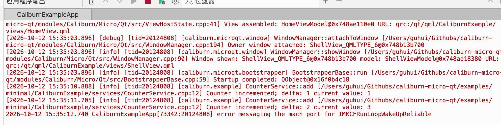
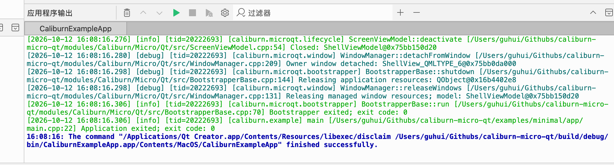

# Qt Creator 日志颜色不生效的诊断与修复

## 1. 问题背景与最终结论

本文记录 2026 年 10 月 12 日在 `caliburn-micro-qt` 示例中，为 Qt Creator 的应用程序输出启用日志等级颜色的完整过程。

示例已经使用 Qt 分类日志，并通过自定义消息处理器，将日志转交给 spdlog，同步输出到控制台与滚动文件。日志正文保留英文，界面文案使用中文。

当时的问题是：应用程序输出中的 Debug、Info 等日志全部显示为红色，正常启动、计数变化、窗口关闭等信息看起来也像错误。

**最终原因分为两个阶段：最初输出配置没有指定着色范围；补齐着色实现后，默认的 `auto` 模式又因为 IDE 使用管道接收输出而未开启颜色。为示例的运行环境添加 `CMQT_LOG_COLOR=always`，重新启动程序后，Debug 显示青色，Info 显示绿色。**

本文涉及的本机环境如下：

| 项目 | 实际环境 |
| --- | --- |
| 操作系统 | macOS 27.0.1，Apple Silicon |
| IDE | Qt Creator 20.0.1 |
| 示例使用的 Qt | Qt 6.8.3 |
| 项目 | `/Users/guhui/Githubs/caliburn-micro-qt` |
| 运行目标 | `CaliburnExampleApp` |
| 日志组件 | Qt 分类日志 → 自定义消息处理器 → spdlog |

这里的 Qt 6.8.3 是示例项目使用的版本，不代表 Qt Creator 自身所带 Qt 库的版本。

## 2. 修复前的现象

下图中，`[debug]` 和 `[info]` 都显示为红色。日志等级、分类、源码位置及正文实际已经正常输出。



图中 `Counter incremented`、`Startup completed` 等是普通业务或框架流程信息。它们显示红色，并不意味着这些操作发生了错误。

原因是示例将各级日志统一写入标准错误流 `stderr`。本次环境中，Qt Creator 在没有收到显式颜色控制信息时，以标准错误流的默认红色显示这些内容。

需要区分三个概念：

| 概念 | 决定的内容 |
| --- | --- |
| 日志等级 | Debug、Info、Warning 等语义，以及是否通过分类过滤 |
| 输出流 | 日志通过 `stdout` 还是 `stderr` 传输 |
| 显示颜色 | 输出组件产生的颜色控制信息，以及终端或 IDE 的渲染结果 |

把 Info 写入 `stderr` 不会将其变成错误日志；相应地，文字显示为红色也不能单独作为故障判断依据。

## 3. 颜色为什么没有生效

### 3.1 第一阶段：没有指定控制台着色范围

初始实现虽然使用了 spdlog 的颜色输出组件，但统一格式仅为：

```cpp
logger->set_pattern("%v");
```

`%v` 代表日志正文，没有标记需要着色的区域。单独使用颜色 sink，并不意味着这段格式会自动按等级给整行上色。

因此，第一阶段的修改是为控制台指定：

```cpp
console->set_pattern("%^%v%$");
```

其中，`%^` 标记颜色范围开始，`%$` 标记结束，`%v` 包含已经由 Qt 格式化的完整日志。这样时间、等级、分类、源码位置和正文都会使用该等级的颜色。

### 3.2 第二阶段：默认自动检测没有启用颜色

补齐控制台着色实现并构建后，再次运行，日志仍然全红。本文的修复前截图记录的就是这个阶段。

此时，示例的颜色配置默认是 `ConsoleColorMode::Automatic`，对应环境变量中的 `auto`。在本机 macOS 上，spdlog 会检查输出是否连接到可着色的终端。Qt Creator 的应用程序输出通过管道捕获程序的 `stderr`，并不是通常意义上的交互终端，因此自动模式没有产生 ANSI 颜色控制码。

同时，检查本机保存的运行配置后发现，`CaliburnExampleApp` 尚未设置 `CMQT_LOG_COLOR=always`。于是形成了如下链条：

```text
控制台已经具备着色能力
→ 运行时使用默认 auto
→ stderr 连接的是 IDE 管道
→ 自动检测未开启颜色
→ Qt Creator 继续按 stderr 默认样式显示
→ Debug、Info 看起来仍然全红
```

Qt Creator 在本机能够渲染程序发送的 ANSI 颜色控制码；后续强制开启颜色后的实测证实了这一点。问题发生在程序是否发送颜色码这一环节。

`CMQT_LOG_COLOR` 是本项目示例输出组件实现的配置项，不是 Qt 或 Qt Creator 的通用内置环境变量。其他项目要使用这个名字，需要有相应读取和处理逻辑。

## 4. 诊断过程与证据

本次按以下顺序逐步缩小问题范围，没有仅凭截图就调整日志等级或更换输出流。

| 检查步骤 | 检查内容 | 结果及意义 |
| --- | --- | --- |
| 源码检查 | 颜色模式读取、颜色 sink、控制台与文件格式 | 已有 `auto/always/never` 支持，控制台设置了 `%^%v%$` |
| 构建产物检查 | 本机示例二进制是否包含 `CMQT_LOG_COLOR` 字符串 | 字符串存在，说明构建产物已包含相关配置代码；这不能代替运行时验证 |
| 运行配置检查 | Qt Creator 保存的示例运行环境 | 未设置强制着色变量，符合默认自动模式未着色的现象 |
| 独立子进程测试 | 在管道下分别使用默认、`auto`、`always`、`never` | 默认和 `auto` 不着色，`always` 产生 ANSI 颜色码，`never` 禁用颜色 |
| 输出一致性测试 | 去掉控制台颜色码后与文件比较 | 日志正文一致，文件不包含颜色转义码 |
| IDE 实际运行 | 添加运行环境变量，启动新的示例进程 | Qt Creator 中 Debug 为青色，Info 为绿色 |
| 用户复验 | 正常关闭程序后的输出截图 | 关闭日志仍保持等级颜色，退出码为 0 |

需要特别区分：**子进程测试验证的是输出字节，窗口实测验证的是最终显示效果。** 自动测试通过时，只能说明着色实现及相关输出行为符合预期；在 IDE 中实际看到颜色之后，才完成本机显示验收。

## 5. 修复步骤

### 5.1 配置控制台和文件各自的格式

示例中的关键配置如下，代码为省略无关部分后的示意：

```cpp
auto console = std::make_shared<spdlog::sinks::stderr_color_sink_mt>(
    colorModeFor(options.consoleColor));
console->set_pattern("%^%v%$");

auto file = std::make_shared<spdlog::sinks::rotating_file_sink_mt>(
    path.toStdString(), options.maxFileSize, options.maxFiles);
file->set_pattern("%v");
```

控制台 sink 负责按等级着色，文件 sink 保留纯文本。所有等级继续通过同一个 `stderr` 输出，不需要为解决颜色问题，将 Info 改写到 `stdout`。

配置各 sink 后，不要再对同一个 logger 调用 `set_pattern("%v")`。logger 的统一格式设置会覆盖其 sink 的格式，使控制台刚设置的着色范围失效。

也不要把 ANSI 颜色码直接拼进 Qt 日志正文或 `QT_MESSAGE_PATTERN`。Qt 格式化后的正文同时进入控制台和文件，提前拼入颜色码会污染文件输出。

本次实现位置在 `caliburn-micro-qt` 项目的 `examples/minimal/app/logging/LoggingRuntime.cpp` 与相应头文件中；颜色配置属于示例的输出组件，没有增加框架公共日志服务。

### 5.2 在 Qt Creator 的运行环境中开启颜色

对于已经包含上述实现的本项目示例，通常只需要完成以下设置：

1. 在 Qt Creator 左侧选择“项目”。
2. 进入当前构建套件的“运行设置”。
3. 确认活动运行配置是 `CaliburnExampleApp`。
4. 展开“环境”的详情。
5. 添加环境变量，变量名为 `CMQT_LOG_COLOR`，值为 `always`。
6. 停止当前示例进程，再重新运行。

最终设置内容为：

```text
CMQT_LOG_COLOR=always
```

要设置的是**示例的运行环境**，不是仅设置 CMake 配置环境或编译环境。颜色模式在日志输出组件初始化时读取；修改环境不会改变已经运行的进程，也不会重新给历史输出上色。

如果当前仍然全红，优先核对活动运行目标、变量名和值、启动的二进制路径，以及是否已经重新启动程序。

### 5.3 普通终端与输出重定向

本机 macOS 上也可以直接指定环境变量启动示例：

```bash
CMQT_LOG_COLOR=always \
  /Users/guhui/Githubs/caliburn-micro-qt/build/debug/bin/CaliburnExampleApp.app/Contents/MacOS/CaliburnExampleApp
```

如果希望将控制台输出保存为没有颜色码的文本，可以禁用颜色并重定向标准错误流：

```bash
CMQT_LOG_COLOR=never \
  /Users/guhui/Githubs/caliburn-micro-qt/build/debug/bin/CaliburnExampleApp.app/Contents/MacOS/CaliburnExampleApp \
  2>console.log
```

强制着色用于已知支持相应颜色控制方式的输出端。CI 或脚本收集输出时，可以使用 `auto` 或 `never`。

## 6. 颜色模式与等级映射

### 6.1 颜色模式

| `CMQT_LOG_COLOR` 的值 | 行为 | 本机使用场景 |
| --- | --- | --- |
| `auto` | 自动检测终端能力；也是未覆盖配置时的默认模式 | 直接运行于普通终端；IDE 管道下可能不着色 |
| `always` | 强制启用颜色输出 | 本次 Qt Creator 应用程序输出 |
| `never` | 禁用颜色 | 保存文本、脚本处理或排查显示问题 |

实现读取变量时会忽略首尾空白及大小写。有效、非空的环境变量优先于 `LoggingOptions::consoleColor`；无效值会输出一次英文降级提示，并使用内部配置。内部配置默认是 `Automatic`。

这些设置只控制颜色，不会改变 Qt 分类过滤阈值，也不会将 Debug 或 Info 提升为错误等级。

### 6.2 等级映射

| Qt 日志等级 | spdlog 等级 | 配置颜色 |
| --- | --- | --- |
| Debug | `debug` | 青色 |
| Info | `info` | 绿色 |
| Warning | `warn` | 加粗黄色 |
| Critical | `err` | 红色 |
| Fatal | `critical` | 加粗红色 |

实际色值由终端或 IDE 的调色板决定。每条日志着色结束后恢复默认样式，避免把后续 IDE 自身的提示染成同一种颜色。

## 7. 修复后截图与验收结果

下图由用户在设置生效后提供。Info 日志为绿色，Debug 日志为青色，程序以退出码 0 正常结束。



截图中的蓝色 `finished successfully` 是 Qt Creator 自身的运行结束提示，沿用 IDE 的显示样式，不是本项目日志等级映射的一部分。

本轮颜色功能的既有验证结果如下；本文编写时核对了保存的测试输出，没有重新运行构建和测试：

| 验证项 | 结果 |
| --- | --- |
| Debug 全量 CTest | 59/59 通过 |
| Release 日志相关 CTest | `logging`、`framework_logging`，2/2 通过 |
| 自动化颜色测试 | 覆盖模式选择、配置优先级、ANSI 颜色范围、自定义格式、并发输出及 Fatal 刷新 |
| 文件输出 | 自动测试确认没有颜色转义码；检查控制台与文件正文的一致性及相关输出次数 |
| 本机 Qt Creator | 实测确认 Debug、Info 显示效果及正常退出 |

本机窗口截图没有展示全部五种等级，不能将截图描述为 Warning、Critical、Fatal 均已完成窗口验收。颜色字节的自动测试与实际显示验证分别记录。

Windows 和银河麒麟的实际显示效果仍需在对应环境验证。当前 Windows 实现使用 spdlog 原生控制台着色，需要实际控制台；不能从 macOS 的结果推断 `always` 在 Windows IDE 管道中也一定有效。

macOS 或第三方组件自行输出的原生诊断，未必经过本项目的消息处理器。例如修复前截图末尾的 `error messaging the mach port...`，仍可能沿用标准错误流的红色。它与项目 Debug、Info 是否成功着色应分别判断。

## 8. 排障期间 Qt Creator 崩溃的补充记录

### 8.1 已确认的堆栈证据

通过界面自动化配置运行环境时，Qt Creator 曾崩溃退出。工具随后报告 `noWindowsAvailable`，这个提示只说明窗口已不可用；检查 macOS 崩溃报告后，才确认是 IDE 进程发生了崩溃。

2026 年 10 月 12 日 15:18:33 和 15:48:41 的报告都记录了主线程的非法内存访问 `EXC_BAD_ACCESS / SIGSEGV`，崩溃位置均在 `libqcocoa.dylib` 的同一偏移。关键调用链为：

```text
HIServices：读取无障碍界面树
→ AppKit：获取控件的无障碍属性
→ Qt Cocoa 插件 libqcocoa.dylib
→ 访问无效内存，Qt Creator 退出
```

界面自动化会使用 macOS 无障碍接口读取按钮、输入框等控件。根据堆栈，崩溃发生于这条读取路径；不能仅凭“点击添加按钮后退出”的时间顺序，就认定添加变量的业务逻辑有错误。

一种可能性是界面更新后，无障碍对象仍引用了失效对象，但这只是推断。现有报告不足以定位到具体源代码错误，也不足以判定 Qt 与 macOS 各自的责任。没有证据表明项目的日志着色逻辑导致了这些 IDE 崩溃。

重新打开项目期间还出现过一次不同的崩溃，15:57:41 的堆栈经过 `QGuiApplication::setOverrideCursor`、`QImage::toCGImage` 和 CoreGraphics，涉及光标图像转换。它与前述无障碍接口崩溃分开记录。

### 8.2 本次实际采取的替代设置方法

通常优先通过 Qt Creator 的运行设置页面添加变量。本次因为界面操作触发崩溃，改用了关闭 IDE 后编辑本机项目配置的方法：

1. 确认 Qt Creator 已关闭，避免其内存中的旧配置覆盖文件修改。
2. 备份项目中的 `.qtcreator/CMakeLists.txt.user`。
3. 找到 `ProjectExplorer.RunConfiguration.BuildKey` 为 `CaliburnExampleApp` 的运行配置。
4. 在其 `PE.EnvironmentAspect.Changes` 中添加 `CMQT_LOG_COLOR=always`，保留其他环境项。
5. 本机配置同时保存了对应的兼容副本，因此对两处示例配置保持一致；没有批量修改其他运行目标。
6. 重新打开 Qt Creator、载入项目，确认运行目标后启动新的示例进程。
7. 实际观察应用程序输出，确认 Debug 青色、Info 绿色。

本机配置中的相关 XML 片段如下，仅用于说明本次文件格式：

```xml
<valuemap type="QVariantMap" key="PE.EnvironmentAspect.Changes">
 <value type="QString" key="File"></value>
 <valuelist type="QVariantList" key="UserItems">
  <value type="QString">CMQT_LOG_COLOR=always</value>
 </valuelist>
</valuemap>
```

不同 Qt Creator 版本的配置结构、运行配置编号及存放位置可能不同。不要直接覆盖已有的 `UserItems`，也不要将某个运行配置编号当作固定编号。编辑前应备份，并按实际结构修改。

本次备份保存为 `/private/tmp/cmqt-creator-before-color-20261012-155550.user`，属于当时的临时恢复文件，不保证长期保留。个人 `.user` 配置不需要提交到仓库。

这一步绕过了当时的界面触发路径，没有修复 Qt Creator 自身的底层崩溃问题。日志颜色功能已经通过实际显示验证，IDE 崩溃则应作为独立问题保留证据。

## 9. 再次遇到类似问题时的检查顺序

1. 先看正文中的等级，区分“日志真的是错误”和“输出面板把 stderr 显示为红色”。
2. 检查是否使用颜色 sink，以及格式中是否包含有效着色范围。
3. 检查是否有后续统一格式设置覆盖了控制台格式。
4. 确认运行的二进制包含新实现，当前活动运行目标正确。
5. 检查实际运行环境中的颜色模式，区分交互终端与 IDE 管道。
6. 对已确认支持颜色的输出端强制启用颜色，然后重新启动进程。
7. 分别验证控制台显示、文件纯文本和输出次数，避免只修好视觉效果却污染文件。
8. 若 IDE 崩溃，读取崩溃报告并单独诊断，避免将界面操作失败误判为日志功能失败。
