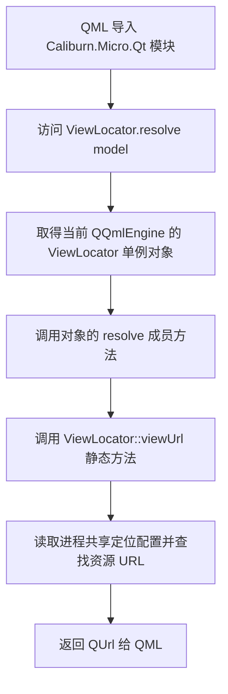
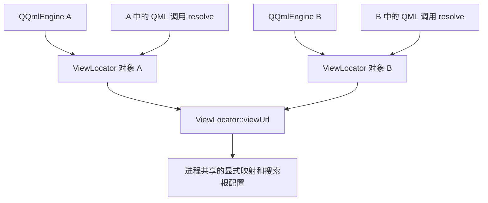

# Qt QML_SINGLETON 与 C++ 静态方法

## 1. 文档目标

本文以 Qt 6.8.3 为基线，解释下面这段代码，以及它在 C++ 和 QML 中的不同调用方式：

```cpp
static QUrl viewUrl(const QObject *model);

Q_INVOKABLE QUrl resolve(QObject *model) const
{
    return ViewLocator::viewUrl(model);
}
```

首先记住：**`resolve()` 是普通成员方法；单例的是 QML 引擎提供的 `ViewLocator` 对象。`viewUrl()` 是静态方法，供成员方法转发调用。**

相关专题：

- [Qt 元对象系统与 QML 类型注册](Qt元对象系统与QML类型注册.md)：理解 `moc`、`Q_OBJECT` 和模块注册。
- [Qt Q_INVOKABLE 与跨平台命令调用对照](Qt%20Q_INVOKABLE与跨平台命令调用对照.md)：理解方法暴露、动态调用及线程边界。
- [Qt Q_PROPERTY 与跨平台双向绑定对照](Qt%20Q_PROPERTY与跨平台双向绑定对照.md)：理解属性通知与界面刷新。

文中的最小工程是教学示例，代码保存在本文中。Qt 官方链接指向 Qt 6.8 系列的维护文档，页面显示的小版本可能高于 6.8.3。

## 2. 四个宏分别负责什么

下面是用于解释调用关系的类声明，省略了定位算法和配置接口：

```cpp
#include <QObject>
#include <QUrl>
#include <QtQml/qqmlregistration.h>

class ViewLocator : public QObject
{
    Q_OBJECT
    QML_ELEMENT
    QML_SINGLETON

public:
    explicit ViewLocator(QObject *parent = nullptr)
        : QObject(parent)
    {
    }

    static QUrl viewUrl(const QObject *model);

    Q_INVOKABLE QUrl resolve(QObject *model) const
    {
        return ViewLocator::viewUrl(model);
    }
};
```

| 标记 | 负责的事情 | 不会自动完成的事情 |
| --- | --- | --- |
| `Q_OBJECT` | 为 QObject 派生类提供自身的元对象信息，支持信号、属性和可调用方法等机制 | 不会把类注册进 QML 模块 |
| `QML_ELEMENT` | 声明使用 C++ 类名作为 QML 类型名，由模块构建流程生成注册信息 | 不会把每个 public 方法都暴露给 QML |
| `QML_SINGLETON` | 声明这个 QML 类型按单例方式提供给引擎 | 不会将所有成员函数变成静态函数，也不会禁止 C++ 创建其他实例 |
| `Q_INVOKABLE` | 将此成员方法加入元对象方法信息，使 QML 等调用方可以访问 | 不负责创建单例，不自动切换线程或异步执行 |

这四个宏分别涉及元对象、类型注册、实例提供方式和方法暴露。它们一起工作，但不能互相替代。

宏还需要配合模块构建：头文件要进入 `qt_add_qml_module()` 的 `SOURCES`，QML 通过对应的 URI 导入模块。第 7 节给出完整示例。

## 3. 为什么 QML 看起来像在调用静态方法

### 3.1 C++ 的类作用域调用

```cpp
QUrl url = ViewLocator::viewUrl(model);
```

`::` 表示 C++ 作用域。这里通过类名调用静态方法，不需要先创建一个 `ViewLocator` 对象。

### 3.2 QML 的单例对象调用

```qml
import Caliburn.Micro.Qt 1.0

// model 是调用位置已经取得的 QObject 模型。
// 这是调用片段，完整的教学工程见第 7 节。
property url selectedView: ViewLocator.resolve(model)
```

QML 中，导入模块后的单例类型名 `ViewLocator` 提供对该引擎中单例对象的访问。表达式中的 `.` 用来访问这个对象的方法。

因此，`ViewLocator.resolve(model)` 的含义是：取得当前引擎的 Locator 对象，调用它的 `resolve()` 成员方法，再由这个成员方法调用 C++ 静态方法。

在 caliburn-micro-qt 中，实际入口是 `ViewHost.qml` 的 `reloadView()`：它调用 `ViewLocator.resolve(state.model)` 获取 URL，再通过 `loader.setSource(url, { viewModel: state.model })` 加载视图并传入模型。定位方法返回地址，创建和注入由宿主继续完成。

| 调用形式 | 发生在哪一层 | 是否需要 Locator 对象 |
| --- | --- | --- |
| `ViewLocator::viewUrl(model)` | C++ 静态调用 | 不需要 |
| `locator.resolve(model)` | C++ 对象成员调用 | 需要，`locator` 是对象 |
| `ViewLocator.resolve(model)` | QML 对单例对象的成员调用 | 需要，由引擎提供 |

`QML_ELEMENT` 单独使用时，常见用法是 `ViewLocator { ... }` 创建对象。加上 `QML_SINGLETON` 后，QML 直接通过类型名访问单例，不再用对象声明语法创建这个类型。

### 3.3 调用流程



这里的转发层让 C++ 调用方保留静态入口，也让 QML 通过对象方法访问同一套定位逻辑。`viewUrl()` 不会仅因为加了 `static` 就自动成为 QML 方法。

## 4. 逐行理解 static、const 和转发

### 4.1 static 修饰函数

```cpp
static QUrl viewUrl(const QObject *model);
```

这里的 `static` 表示静态成员函数：

- 函数属于类的作用域，调用时不需要某个 Locator 实例。
- 函数没有 `this` 指针，不能直接读取某个 Locator 实例的非静态字段。
- 函数可以访问静态数据，也可以操作通过参数传入的数据。

`const QObject *model` 表示通过这个指针以只读方式访问模型，不允许直接调用模型的非 const 方法。它不表示模型在其他地方永远不会变化。

### 4.2 const 修饰成员函数

```cpp
Q_INVOKABLE QUrl resolve(QObject *model) const
```

末尾的 `const` 修饰当前 Locator 对象：在函数体中，不能直接修改它的普通非静态数据成员，也不能通过 `this` 调用非 const 成员方法。

它不意味着函数绝对没有副作用。例如，const 成员函数仍可能修改静态数据、`mutable` 成员，或者通过指针操作其他对象。这里的参数是 `QObject *`，末尾的 `const` 不会使这个模型也变成只读对象。

| 写法 | 修饰什么 | 含义 |
| --- | --- | --- |
| `static QUrl viewUrl(...)` | 函数 | 调用不依赖 Locator 实例，没有 `this` |
| `const QObject *model` | 指针所指向的模型 | 通过此指针只读访问模型 |
| `QUrl resolve(...) const` | 当前 Locator 对象 | 限制通过 `this` 修改当前对象 |

静态成员函数没有 `this`，所以不能写成 `static QUrl viewUrl(...) const`。

### 4.3 普通成员方法为什么能调用静态方法

```cpp
Q_INVOKABLE QUrl resolve(QObject *model) const
{
    return ViewLocator::viewUrl(model);
}
```

这只是一次普通的 C++ 函数调用：成员方法运行时，将参数交给静态方法，再返回结果。

在同一个类的成员函数中写 `return viewUrl(model);` 也合法，编译器可以找到本类的静态成员。这里写全 `ViewLocator::viewUrl(model)`，是为了明确告诉读者：调用的是类的静态方法。

`QObject *` 可以传给接受 `const QObject *` 的函数，因此这个转发不需要类型转换。

转发层不复制定位逻辑，也不会因为调用了静态方法而变成静态方法。`Q_INVOKABLE` 则使外层 `resolve()` 能从 QML 进入。

## 5. QML 单例的创建、寿命与线程

### 5.1 默认按引擎创建，首次访问时实例化

在本文采用的 `QML_ELEMENT`、`QML_SINGLETON` 和公开默认构造函数方案下，每个 `QQmlEngine` 按需创建自己的实例。仅导入模块不等于已经构造对象；首次访问时才触发实例化。同一引擎后续访问会取得同一个对象。

Qt 也支持静态工厂 `create(QQmlEngine *, QJSEngine *)`。如果可访问的默认构造函数和工厂同时存在，默认构造函数优先。通常由引擎拥有单例对象，并在引擎销毁时释放；自定义所有权时需要另行设计寿命。[官方说明：QML_SINGLETON](https://doc.qt.io/qt-6.8/qqmlintegration-h.html#QML_SINGLETON)

### 5.2 不限制 C++ 创建其他实例

如果构造函数公开，下面的 C++ 代码仍然合法：

```cpp
ViewLocator localLocator;
QUrl url = localLocator.resolve(model);
```

`localLocator` 是普通 C++ 局部对象，不会自动取代引擎中的单例对象。`QML_SINGLETON` 不是 C++ 的私有构造函数或全局实例访问器。

### 5.3 不自动提供线程安全

单例只描述实例提供方式，不会给数据读写加锁。`Q_INVOKABLE` 也不会自动把调用投递到工作线程。

以本文讨论的 Locator 为例，配置和查询限定应用主线程，模型也属于该线程。这个限制来自 Locator 的接口契约，需要由实现检查。若其他服务允许多个线程访问共享可变状态，就必须另外设计同步方式。

## 6. 每引擎对象与进程共享配置是两件事

Locator 可以采用以下结构：

- 引擎 A 持有 Locator A，用来接收 A 中 QML 发起的调用。
- 引擎 B 持有 Locator B，用来接收 B 中 QML 发起的调用。
- 两个对象的方法都调用静态定位入口；静态入口读取同一份进程级配置。



| 内容 | 由什么机制决定 | 范围 |
| --- | --- | --- |
| QML 使用的 Locator 对象 | QML 单例注册与引擎实例化 | 默认每个引擎一个 |
| 显式映射、搜索根等配置 | C++ 中共享存储的设计 | 在此 Locator 设计中按进程共享 |
| 模型对象 | 业务创建和所有权规则 | 不由 Locator 单例规则决定 |

**静态方法本身不等于静态配置。** 一个静态方法也可以只处理参数，完全不保存数据。共享配置需要实现者主动选择静态存储或其他共享存储。

同样，`QML_SINGLETON` 不会自动把非静态字段变成进程共享字段。若搜索根保存在每个 Locator 对象的普通成员里，不同引擎就会得到各自的配置。

不要把上图理解成两个引擎共用同一个 QObject。提供预先创建的单例对象涉及额外的引擎、线程和所有权限制，需要遵守对应注册方式的要求。[官方说明：Singletons in QML](https://doc.qt.io/qt-6.8/qml-singleton.html)

## 7. 最小 C++、CMake、QML 示例

为了单独观察单例和方法转发，这里使用 `AppInfo`，不引入 ViewModel 注册或资源定位算法。示例的共享数据是不可变字符串，不模拟完整的 Locator 配置。

目录结构：

```text
SingletonDemo/
├── CMakeLists.txt
├── AppInfo.h
├── main.cpp
└── Main.qml
```

### 7.1 AppInfo.h

```cpp
#pragma once

#include <QObject>
#include <QString>
#include <QtQml/qqmlregistration.h>

class AppInfo : public QObject
{
    Q_OBJECT
    QML_ELEMENT
    QML_SINGLETON

public:
    explicit AppInfo(QObject *parent = nullptr)
        : QObject(parent)
    {
    }

    // C++ 静态入口，不依赖 AppInfo 对象。
    static QString buildLabel()
    {
        // 普通单可执行文件工程中，这份不可变数据由各实例共享。
        static const QString label = QStringLiteral("Qt QML 单例示例");
        return label;
    }

    // QML 入口，调用的是引擎提供的 AppInfo 对象。
    Q_INVOKABLE QString describe() const
    {
        return AppInfo::buildLabel();
    }
};
```

这里的函数内 `static const QString` 是静态存储的局部变量；第 4 节的 `static` 成员函数则是一种函数声明。它们都写作 `static`，但作用不同。

### 7.2 main.cpp

```cpp
#include <QGuiApplication>
#include <QQmlApplicationEngine>

int main(int argc, char *argv[])
{
    QGuiApplication app(argc, argv);
    QQmlApplicationEngine engine;

    engine.loadFromModule("SingletonDemo", "Main");
    if (engine.rootObjects().isEmpty())
        return 1;

    return app.exec();
}
```

应用先创建，引擎后创建。函数返回时，引擎先析构，释放它拥有的 QML 对象与单例，然后应用析构。

### 7.3 Main.qml

```qml
import QtQuick
import SingletonDemo

Window {
    width: 480
    height: 240
    visible: true
    title: "QML_SINGLETON"

    Text {
        anchors.centerIn: parent
        text: AppInfo.describe()
    }
}
```

`AppInfo.describe()` 触发对单例对象的访问。该对象调用 `describe()`，后者返回 `AppInfo::buildLabel()` 的结果。

示例文本是固定值。真实业务若需要配置变化后自动刷新界面，应使用具有适当通知机制的 `Q_PROPERTY`；仅在静态数据变化后重新返回不同值，不会自动通知已有 QML 绑定重新求值。

### 7.4 CMakeLists.txt

```cmake
cmake_minimum_required(VERSION 3.21)
project(SingletonDemo LANGUAGES CXX)

set(CMAKE_CXX_STANDARD 17)
set(CMAKE_CXX_STANDARD_REQUIRED ON)

find_package(Qt6 6.8.3 REQUIRED COMPONENTS Quick)
qt_standard_project_setup(REQUIRES 6.8)

qt_add_executable(appSingletonDemo
    main.cpp
)

qt_add_qml_module(appSingletonDemo
    URI SingletonDemo
    VERSION 1.0
    SOURCES AppInfo.h
    QML_FILES Main.qml
)

target_link_libraries(appSingletonDemo PRIVATE Qt6::Quick)
```

`find_package()` 指定最低版本；实际使用哪个 Qt 安装由 Qt Creator Kit 或 CMake 搜索路径决定。使用 Qt 6.8.3 Kit 可以复现本文基线。

可执行目标使用 `appSingletonDemo`，QML 模块 URI 使用 `SingletonDemo`。分开命名可避免某些构建布局中可执行文件与生成的模块目录同名。

`qt_add_qml_module()` 让构建工具扫描 `AppInfo.h` 的 QML 注册信息，生成模块元数据和注册代码。这里使用声明式注册，不需要再手动调用 `qmlRegisterSingletonType()`。[官方说明：qt_add_qml_module](https://doc.qt.io/qt-6.8/qt-add-qml-module.html)

## 8. 常见误解

| 误解 | 正确理解 |
| --- | --- |
| `resolve()` 是单例方法，所以它是 static | 它是普通成员方法；QML 通过单例对象调用它 |
| QML 的 `ViewLocator.resolve()` 等于 C++ 的 `ViewLocator::resolve()` | QML 的点号访问单例对象；C++ 用类名直接调用需要对应静态方法 |
| 只写 `QML_SINGLETON` 就能从任意 QML 使用 | 还需要类型注册、模块构建与 import |
| public 方法都能在 QML 调用 | 普通方法需要 `Q_INVOKABLE`、public slot 等适当的元对象暴露方式 |
| 单例意味着整个进程只有一个 QObject | 本文默认方案按引擎提供对象；C++ 还可以创建额外实例 |
| 加了宏就不能 `new AppInfo` | 是否能从 C++ 构造取决于构造函数访问权限等 C++ 规则 |
| `resolve() const` 不能调用 static 方法 | 可以；静态方法不依赖 `this` |
| `const` 意味着所有共享状态都不会改变 | 它主要限制通过当前对象修改普通实例状态 |
| 所有单例都天然线程安全 | 实例数量和线程同步是不同问题 |
| 调用 invokable 会自动异步执行 | 普通 QML 方法调用仍需遵守对象所属线程及接口契约 |
| 修改共享静态变量会自动刷新 QML | 界面刷新需要属性通知等明确机制 |

## 9. 适用场景

QML 单例适合提供当前引擎内统一访问的服务，例如视图定位、主题信息、只读应用信息和统一的设置入口。

当 C++ 也需要调用同一套能力时，可以像 Locator 一样保留静态业务入口，并提供小型 invokable 成员方法转发。是否使用静态配置，要根据配置范围、测试隔离和线程要求另外决定。

页面自身的编辑状态、每个窗口独立的模型，以及需要分别销毁的业务对象，更适合通过具体对象传入页面。只有服务需要统一入口，并不意味着所有业务状态都应该放入单例。

## 10. 官方参考资料

- [QML_SINGLETON](https://doc.qt.io/qt-6.8/qqmlintegration-h.html#QML_SINGLETON)：构造方式、工厂优先级、引擎所有权及现有实例的限制。
- [QML_ELEMENT](https://doc.qt.io/qt-6.8/qqmlintegration-h.html#QML_ELEMENT)：声明 QML 类型名称和模块注册。
- [Singletons in QML](https://doc.qt.io/qt-6.8/qml-singleton.html)：QML 单例的定义、注册与访问。
- [Q_INVOKABLE](https://doc.qt.io/qt-6.8/qobject.html#Q_INVOKABLE)：将方法加入元对象系统。
- [qt_add_qml_module](https://doc.qt.io/qt-6.8/qt-add-qml-module.html)：模块构建、类型信息及自动注册。
