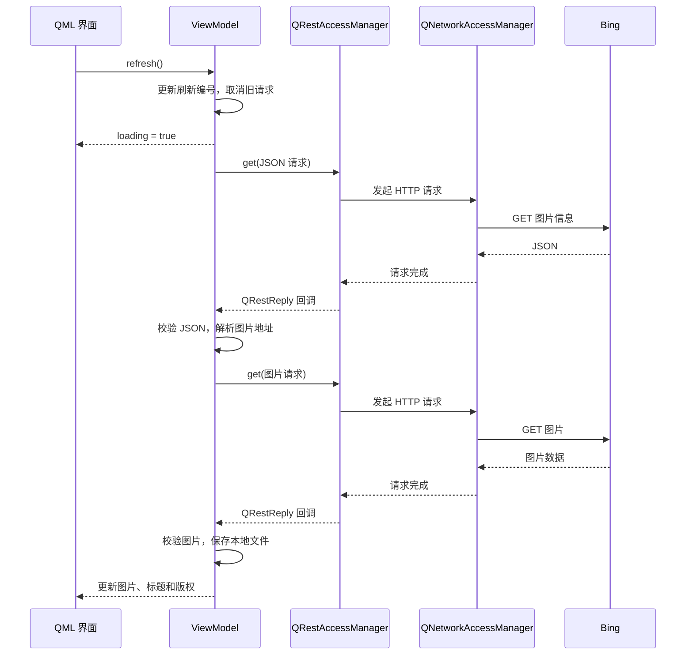

# Qt 原生 HTTP 实战——从 JSON 请求到图片下载

最近在做一个 Qt“每日一图”小项目：从 Bing 获取当天的图片信息，下载图片，在界面上显示图片、标题和版权，再提供一个刷新按钮。

需求看起来只有两次 GET 请求，但真正写下来，还要处理异步回调、对象生命周期、下载失败、超时，以及连续刷新时旧结果覆盖新结果的问题。

这篇文章结合项目实现，介绍 Qt 原生网络库的使用方式，重点是两个类：

- `QNetworkAccessManager`：负责底层网络访问。
- `QRestAccessManager`：在前者之上提供更方便的请求与响应处理接口。

项目使用 **Qt 6.8.3、C++17、Qt Quick/QML**。下面的项目代码做了必要节选或等价精简，省略部分日志和重复检查；额外提供的教学示例会单独标明。

## 一、先把需求整理成一次完整的请求流程

每日一图的数据分成两部分。

第一次请求获取 JSON，里面包含标题、版权和图片地址：

```text
https://cn.bing.com/HPImageArchive.aspx?format=js&idx=0&n=1&mkt=zh-CN
```

项目关心的响应结构可以简化为：

```json
{
  "images": [
    {
      "title": "图片标题",
      "copyright": "图片说明及版权",
      "url": "/th?id=..."
    }
  ]
}
```

第二次请求访问解析后的图片地址，获取图片二进制数据。

项目采用最简 MVVM：QML 负责显示和按钮交互，C++ ViewModel 负责请求及状态管理。



选择 Qt 原生方案，主要是因为它已经能够配合项目的事件循环、信号槽和 QObject 生命周期，不需要额外引入 HTTP 库，也减少了网络回调与界面状态之间的衔接工作。

**当前项目获取 JSON 和下载图片都通过 `QRestAccessManager`，底层共用一个 `QNetworkAccessManager`。**

## 二、认识 Qt Network 中的几个核心类

Qt Network 是模块名称，其中与这次 HTTP 调用直接相关的类如下：

| 类 | 主要职责 |
|---|---|
| `QNetworkAccessManager` | 发起网络请求，管理公共网络配置 |
| `QNetworkRequest` | 描述 URL、请求头和请求选项 |
| `QNetworkReply` | 提供响应数据、HTTP 状态、进度、错误及取消能力 |
| `QRestAccessManager` | 包装底层 manager，简化常见 HTTP 调用 |
| `QRestReply` | 包装底层 reply，提供成功判断、JSON 和响应体读取 |
| `QNetworkRequestFactory` | 根据 Base URL、公共配置、路径和查询参数创建请求 |

这里需要分清两组关系：

```text
QRestAccessManager  → 使用 → QNetworkAccessManager

QRestReply         → 包装 → QNetworkReply
```

`QRestAccessManager` 是便利封装，并不接管底层 manager 的所有权。它从 Qt 6.7 开始提供，本文使用项目实际采用的 Qt 6.8.3。[官方说明](https://doc.qt.io/qt-6.8/qrestaccessmanager.html)

构建时，这些网络类统一来自 `Qt6::Network`：

```cmake
find_package(Qt6 6.8.3 REQUIRED COMPONENTS Network)

target_link_libraries(your_target PRIVATE Qt6::Network)
```

完整的 Qt Quick 应用还需要链接相应的界面模块，这里只列出网络部分。

### REST 封装可以下载图片吗？

可以。

REST 是接口设计风格。图片下载通常也是一次 HTTP GET，`QRestAccessManager` 可以发起这个请求，并读取返回的二进制数据。

对本项目而言，两类响应的主要区别是读取方式：

```cpp
// 图片信息：解析 JSON。
const auto json = response.readJson();

// 图片内容：读取二进制数据。
const QByteArray bytes = response.readBody();
```

这分别用于两个不同请求。后面还会讲到，同一个响应的数据不能随意重复读取。

## 三、先看底层 manager 怎样调用 HTTP

先不使用 REST 封装，看一个直接调用 `QNetworkAccessManager` 的教学示例。

这里假设 `network` 是长期存活的网络对象，`context` 是有效的 QObject，并且两者位于同一线程：

```cpp
void requestJson(QNetworkAccessManager &network, QObject *context)
{
    QNetworkRequest request(QUrl(QStringLiteral(
        "https://cn.bing.com/HPImageArchive.aspx"
        "?format=js&idx=0&n=1&mkt=zh-CN")));

    request.setRawHeader("Accept", "application/json");

    // 本示例手动安排清理，覆盖 manager 的自动删除设置。
    request.setAttribute(
        QNetworkRequest::AutoDeleteReplyOnFinishAttribute, false);

    auto *reply = network.get(request);

    // 清理连接独立于业务 context，避免 context 提前销毁后遗漏清理。
    QObject::connect(reply, &QNetworkReply::finished,
                     reply, &QObject::deleteLater);

    QObject::connect(reply, &QNetworkReply::finished,
                     context, [reply] {
        const int status = reply->attribute(
            QNetworkRequest::HttpStatusCodeAttribute).toInt();

        if (reply->error() != QNetworkReply::NoError
            || status < 200 || status >= 300) {
            qWarning() << "请求失败"
                       << status << reply->errorString();
            return;
        }

        const QByteArray body = reply->readAll();
        qInfo() << body;
    });
}
```

这段代码有三个重要环节。

**第一，`get()` 返回的是请求过程对象。**

返回时，响应通常还没有下载完成。先拿到 `QNetworkReply *`，然后通过信号等待结果。

**第二，`finished` 表示请求结束，成功和失败都会结束。**

所以不能进入这个回调就直接当成成功。示例同时检查 Qt 错误和 HTTP 状态；两者可能同时反映同一次失败，例如服务端返回 404。

**第三，结束后需要清理 reply。**

这里使用 `deleteLater()`，让 Qt 安排延迟删除，避免在 `finished` 信号处理过程中直接销毁对象。manager 销毁时也会清理其子 reply，但长期存活的 manager 不适合一直积攒已经完成的响应对象。[网络管理器文档](https://doc.qt.io/qt-6.8/qnetworkaccessmanager.html)

### 异步请求为什么不会一直卡住界面？

调用流程大致是：

```text
调用 get()
    ↓
取得 reply，当前函数返回
    ↓
事件循环继续处理界面和网络事件
    ↓
请求结束，执行回调
```

使用这个异步 API，不需要为了等待 HTTP 响应，自己再创建一个工作线程。

不过，**异步等待不意味着回调中的所有操作都不会阻塞**。在界面线程里执行大量 JSON 处理、图片解码或文件写入，仍然可能影响响应速度。

另外，manager 必须在其所属线程使用，不能把同一个对象随意跨线程调用。[线程与异步说明](https://doc.qt.io/qt-6.8/qnetworkaccessmanager.html)

## 四、使用 QRestAccessManager 请求 JSON

有了底层概念，再看项目如何组织网络对象。

ViewModel 中保存这些成员：

```cpp
QNetworkAccessManager *m_network;
QRestAccessManager m_rest;
QNetworkRequestFactory m_api;

QPointer<QNetworkReply> m_active;
QTemporaryDir m_downloadDir;
quint64 m_generation = 0;
```

构造函数如下：

```cpp
DailyPictureViewModel::DailyPictureViewModel(
    QObject *parent,
    QNetworkAccessManager *network)
    : QObject(parent),
      m_network(network ? network
                        : new QNetworkAccessManager(this)),
      m_rest(m_network)
{
    m_network->setAutoDeleteReplies(true);
    m_network->setTransferTimeout(10000);

    m_network->setRedirectPolicy(
        QNetworkRequest::NoLessSafeRedirectPolicy);

    m_api.setBaseUrl(
        QUrl(QStringLiteral("https://cn.bing.com")));
}
```

正常运行时，ViewModel 创建 manager，并通过 QObject 父子关系管理它。

测试时则可以传入模拟 manager。此时外部对象必须活得比 ViewModel 更久，而且这个构造函数也会修改传入对象的网络配置。

`m_rest(m_network)` 建立了两者的关联；`m_api` 负责生成请求，本身不发送请求。

### 1. 创建请求

项目使用 `QUrlQuery` 管理参数：

```cpp
QUrlQuery query;
query.addQueryItem(QStringLiteral("format"), QStringLiteral("js"));
query.addQueryItem(QStringLiteral("idx"), QStringLiteral("0"));
query.addQueryItem(QStringLiteral("n"), QStringLiteral("1"));
query.addQueryItem(QStringLiteral("mkt"), QStringLiteral("zh-CN"));

auto request = m_api.createRequest(
    QStringLiteral("/HPImageArchive.aspx"), query);

request.setRawHeader("Accept", "application/json");

request.setAttribute(
    QNetworkRequest::CacheLoadControlAttribute,
    QNetworkRequest::AlwaysNetwork);
```

Base URL、接口路径和查询参数分别表达，代码比手动拼接整段 URL 更清楚。请求工厂也便于集中管理同一服务的公共配置。[请求工厂文档](https://doc.qt.io/qt-6.8/qnetworkrequestfactory.html)

`Accept` 表达期望的响应类型，仍然需要检查实际内容。

`AlwaysNetwork` 要求访问网络，避免直接使用本地 HTTP 缓存满足刷新。它不保证远端 CDN 返回的内容一定发生变化。

### 2. 发起请求并读取 JSON

以下是项目回调的精简版本：

```cpp
auto *reply = m_rest.get(request, this,
    [this, generation](QRestReply &response) {
        if (generation != m_generation)
            return;

        m_active.clear();

        if (!response.isSuccess()) {
            fail(requestError(
                QStringLiteral("获取图片信息"),
                response.networkReply()));
            return;
        }

        QJsonParseError parseError;
        const auto json = response.readJson(&parseError);

        if (!json || !json->isObject()) {
            fail(QStringLiteral("图片信息不是有效的 JSON 对象。"));
            return;
        }

        const auto images = json->object()
            .value(QStringLiteral("images")).toArray();

        if (images.isEmpty() || !images.first().isObject()) {
            fail(QStringLiteral("没有找到当天的图片信息。"));
            return;
        }

        const auto item = images.first().toObject();
        const auto title = item.value("title").toString();
        const auto copyright = item.value("copyright").toString();
        const auto path = item.value("url").toString();

        if (title.isEmpty() || copyright.isEmpty() || path.isEmpty()) {
            fail(QStringLiteral("图片信息不完整。"));
            return;
        }

        const auto url =
            response.networkReply()->url().resolved(QUrl(path));

        if (!url.isValid() || url.scheme() != QStringLiteral("https")
            || url.host().isEmpty()) {
            fail(QStringLiteral("图片地址无效。"));
            return;
        }

        downloadImage(url, title, copyright, generation);
    });

track(reply);
```

校验分成三个层次：

```text
HTTP 请求成功
    ↓
响应能解析为预期的 JSON 对象
    ↓
业务字段完整，可以继续下载
```

`isSuccess()` 综合检查 HTTP 2xx 状态及接收过程中的错误。`readJson()` 返回 `std::optional<QJsonDocument>`，因此需要先判断有没有值，再访问 JSON。[响应处理文档](https://doc.qt.io/qt-6.8/qrestreply.html)

图片地址使用实际响应 URL 配合 `resolved()` 解析，能够处理 `/th?...` 这样的相对路径，也能考虑重定向后的基础地址。

### 3. 回调中的 this 有什么作用？

调用形式是：

```cpp
m_rest.get(request, this,
           [this, generation](QRestReply &response) {
    // ...
});
```

其中有两种不同的 `this`：

- 参数中的 `this` 是回调上下文；上下文销毁后，Qt 不再调用该回调。
- lambda 捕获中的 `this` 让回调能够访问 ViewModel 成员。

上下文保护不会自动延长 ViewModel 的生命，也不等于取消了网络请求。

回调参数 `QRestReply &response` 只在这次回调执行期间有效。项目直接在回调里提取 JSON、字符串和字节数据，不把这个引用保存到成员中。[回调生命周期说明](https://doc.qt.io/qt-6.8/qrestaccessmanager.html)

## 五、使用同一套封装下载图片

得到完整图片地址后，再调用一次 `m_rest.get()`。

下面节选项目的核心逻辑：

```cpp
QNetworkRequest request(url);
request.setAttribute(
    QNetworkRequest::CacheLoadControlAttribute,
    QNetworkRequest::AlwaysNetwork);

auto *reply = m_rest.get(request, this,
    [this, generation, title, copyright](QRestReply &response) {
        if (generation != m_generation)
            return;

        m_active.clear();

        if (!response.isSuccess()) {
            fail(requestError(
                QStringLiteral("下载图片"),
                response.networkReply()));
            return;
        }

        const auto bytes = response.readBody();

        if (QImage::fromData(bytes).isNull()) {
            fail(QStringLiteral("下载内容不是有效图片。"));
            return;
        }

        const auto path = m_downloadDir.filePath(
            QStringLiteral("daily-%1.img").arg(generation));

        QSaveFile file(path);
        if (!file.open(QIODevice::WriteOnly)
            || file.write(bytes) != bytes.size()
            || !file.commit()) {
            fail(QStringLiteral("无法保存图片。"));
            return;
        }

        m_title = title;
        m_copyright = copyright;
        m_imageUrl = QUrl::fromLocalFile(path);
        m_loading = false;

        emit stateChanged();
    });

track(reply);
```

`title` 和 `copyright` 按值捕获，因为下载完成时，发起下载的函数早已返回。

这里先确认 HTTP 成功，再确认内容可以解码为图片。这样即使服务端返回 HTTP 200，响应体实际是错误文本，也不会直接交给界面。

保存使用 `QSaveFile`：先写临时文件，成功后通过 `commit()` 提交到目标位置；没有成功提交的写入会被丢弃。[QSaveFile 文档](https://doc.qt.io/qt-6.8/qsavefile.html)

每轮刷新使用不同的文件路径，随后用 `QUrl::fromLocalFile()` 转为 QML 可以使用的 URL。

**图片保存成功后，才一起更新标题、版权和图片地址。** 因此第二阶段失败时，界面不会出现“新标题搭配旧图片”的状态。

还要记住，响应体是会被消费的数据流。如果先调用 `readBody()`，再调用 `readJson()`，后者无法重新获得已经读走的完整内容。需要多种处理时，应先读取并保存字节，再基于保存的数据解析。[响应读取说明](https://doc.qt.io/qt-6.8/qrestreply.html)

## 六、下载为什么仍然要理解底层 reply？

项目虽然没有直接调用 `m_network->get()` 下载图片，但底层能力一直存在：

```cpp
QNetworkReply *reply = m_rest.get(...);
```

这个返回值可以用于进度通知、取消及流式读取。

### 1. 监听进度和取消请求

进度监听不会消费响应体，可以与项目的完成回调配合：

```cpp
connect(reply, &QNetworkReply::downloadProgress,
        this, [](qint64 received, qint64 total) {
    if (total > 0) {
        const double percent = 100.0 * received / total;
        qDebug() << "下载进度：" << percent << "%";
    } else {
        qDebug() << "已下载：" << received << "字节";
    }
});
```

总大小可能未知，所以不能无条件计算百分比。

取消则调用：

```cpp
reply->abort();
```

实际保存待取消对象时，项目使用：

```cpp
QPointer<QNetworkReply> m_active;
```

`QPointer` 在目标 QObject 销毁后会自动变空，适合观察可能被自动清理的 reply。**它不拥有对象，也不负责删除对象。**

### 2. 小图片整包读取，大文件分块写入

项目采用：

```text
下载完成 → readBody() → 校验图片 → 保存文件
```

实现简单，但完整图片数据会留在内存中，解码检查还会带来额外内存开销。

大文件下载可以监听 `readyRead`，收到一部分就写入文件。`QNetworkReply` 是顺序读取的 `QIODevice`，已读走的数据不会继续保留供下一次读取。[底层响应文档](https://doc.qt.io/qt-6.8/qnetworkreply.html)

下面是**教学补充示例**，直接使用 `QNetworkAccessManager`。需要包含 Qt Network 相关头文件、`QSaveFile`、`QDebug` 和 `<memory>`：

```cpp
QNetworkReply *downloadToFile(QNetworkAccessManager &network,
                             const QUrl &url,
                             const QString &path)
{
    auto file = std::make_shared<QSaveFile>(path);
    if (!file->open(QIODevice::WriteOnly)) {
        qWarning() << "打开文件失败" << file->errorString();
        return nullptr;
    }

    QNetworkRequest request(url);
    request.setAttribute(
        QNetworkRequest::AutoDeleteReplyOnFinishAttribute, true);

    auto *reply = network.get(request);
    reply->setReadBufferSize(64 * 1024);

    auto drain = [reply, file] {
        const QByteArray bytes = reply->readAll();
        return bytes.isEmpty()
            || file->write(bytes) == bytes.size();
    };

    QObject::connect(reply, &QNetworkReply::readyRead,
                     reply, [reply, file, drain] {
        if (!drain()) {
            reply->setProperty("fileWriteFailed", true);
            file->cancelWriting();
            reply->abort();
        }
    });

    QObject::connect(reply, &QNetworkReply::finished,
                     reply, [reply, file, drain] {
        const int status = reply->attribute(
            QNetworkRequest::HttpStatusCodeAttribute).toInt();

        if (reply->property("fileWriteFailed").toBool()
            || reply->error() != QNetworkReply::NoError
            || status < 200 || status >= 300
            || !drain()) {
            file->cancelWriting();
            qWarning() << "下载或写入失败"
                       << status << reply->errorString()
                       << file->errorString();
            return;
        }

        if (!file->commit())
            qWarning() << "提交文件失败" << file->errorString();
    });

    return reply;
}
```

这里的 `readAll()` 读取的是当前已经到达、尚未读取的数据。结合 `readyRead` 和读取缓冲区设置，避免一直等待整个文件进入内存。

`std::shared_ptr` 保证文件对象能够存活到异步处理结束；完成回调再读取剩余数据，全部成功后才提交文件。

如果想继续使用 REST 封装，可以将发起请求的一行换为：

```cpp
auto *reply = rest.get(request);
```

再使用相同的底层信号处理数据。此时不应另外在完成回调中用 `readBody()` 期待读回完整文件，因为数据已经分批写入磁盘。

两个教学示例已通过 Qt 6.8.3 的编译器语法检查，分块下载示例未单独进行联网运行验证。

## 七、让刷新逻辑可靠：取消、超时与生命周期

### 1. 连续刷新，为什么取消之后还要检查编号？

设想用户连续刷新两次：

```text
第一轮请求开始
第二轮请求开始
第二轮请求完成
第一轮回调晚到
```

如果回调直接更新界面，第一轮旧结果就可能覆盖第二轮结果。

项目为每轮刷新分配编号：

```cpp
const quint64 generation = ++m_generation;

if (m_active) {
    const auto oldReply = m_active;
    m_active.clear();
    oldReply->abort();
}
```

每个回调开头检查：

```cpp
if (generation != m_generation)
    return;
```

取消用于减少无用工作，编号检查用于保证状态正确。

这里还有一个执行顺序问题：`abort()` 可能立即触发旧请求的完成处理。因此必须先增加编号，再取消，确保旧回调立即执行时也能判断自己已经过期。

项目析构时同样先增加编号，再取消当前请求，避免销毁过程中处理旧业务结果。

### 2. 两种超时解决不同问题

公共 manager 设置：

```cpp
m_network->setTransferTimeout(10000);
```

表示长时间没有数据交换时中止传输，不能理解为请求最多只能执行十秒。[传输超时定义](https://doc.qt.io/qt-6.8/qnetworkrequest.html#setTransferTimeout)

项目另外为每次请求安排总时限：

```cpp
void DailyPictureViewModel::track(QNetworkReply *reply)
{
    m_active = reply;

    QTimer::singleShot(30000, reply, [reply] {
        if (!reply->isFinished()) {
            reply->setProperty("deadlineExceeded", true);
            reply->abort();
        }
    });
}
```

| 设置 | 目的 |
|---|---|
| 10 秒传输超时 | 避免网络长时间没有数据交换 |
| 每个请求 30 秒总时限 | 避免持续零星传输导致请求一直不结束 |

JSON 和图片请求分别计时，整个刷新流程没有共用一个 30 秒期限。

定时器使用 reply 作为上下文，对象销毁后不会再执行回调。`deadlineExceeded` 是项目自定义属性，用于区分总超时取消与其他取消原因。

这些定时器依赖事件循环，回调被阻塞时也会延迟执行。

### 3. 清理策略保持一致

项目启用：

```cpp
m_network->setAutoDeleteReplies(true);
```

因此项目回调不再手动删除 reply，也不在回调结束后继续使用裸指针。

第三节的教学示例则明确关闭该请求的自动删除，使用独立的 `deleteLater()` 连接负责清理。理解两种方式的前提，比机械复制某一句清理代码更重要。[自动删除设置](https://doc.qt.io/qt-6.8/qnetworkaccessmanager.html#setAutoDeleteReplies)

### 4. 刷新失败，保留上一次成功内容

开始刷新时只更新加载状态：

```cpp
m_loading = true;
m_error.clear();
emit stateChanged();
```

失败时只更新错误状态：

```cpp
m_loading = false;
m_error = message;
emit stateChanged();
```

旧图片、标题和版权保持原值，直到新图片下载并保存成功。

项目已有模拟网络测试覆盖了正常加载、非法 JSON、字段缺失、无效图片、HTTP 503、重复刷新、取消图片下载及临时文件清理。其中还模拟了取消后旧响应继续晚到的情况，验证编号检查确实有效。

项目记录显示，macOS / Qt 6.8.3 下已有 14 项 Qt Test 通过，并完成真实 Bing 下载和连续刷新验证；这是已有验证记录，本次写作没有重新运行整套测试。

## 八、把结果交给 QML

HTTP 部分处理完成后，通过属性通知界面即可：

```cpp
Q_PROPERTY(QString title READ title NOTIFY stateChanged)
Q_PROPERTY(QString copyright READ copyright NOTIFY stateChanged)
Q_PROPERTY(QUrl imageUrl READ imageUrl NOTIFY stateChanged)
Q_PROPERTY(bool loading READ loading NOTIFY stateChanged)
Q_PROPERTY(QString error READ error NOTIFY stateChanged)

Q_INVOKABLE void refresh();
```

对应属性具有 getter，更新后发出 `stateChanged()`。

QML 绑定本地图片地址：

```qml
Image {
    source: window.viewModel.imageUrl
    fillMode: Image.PreserveAspectFit
    asynchronous: true
    cache: false
}

Button {
    text: window.viewModel.loading ? "重新刷新" : "刷新"
    onClicked: window.viewModel.refresh()
}
```

加载期间按钮仍可点击，由 ViewModel 处理旧请求取消和新一轮刷新。新的本地文件路径用于触发图片更新，`QTemporaryDir` 在正常析构时清理本次运行产生的文件。

图片地址和文字在 C++ 中一起发布后，QML 仍需要加载、解码本地图片，因此不代表图片像素和文字一定在同一帧切换。

这个项目也让我对 Qt HTTP 调用形成了更清晰的认识：`QNetworkAccessManager` 提供基础网络访问，`QRestAccessManager` 简化日常调用，而 `QNetworkReply` 保留对请求过程的控制能力。获取 JSON、下载图片、监听进度和取消请求，都可以在同一套 Qt Network 体系中完成。

项目仓库：[qt_daliy_picture](https://github.com/soapgu/qt_daliy_picture)。

进一步查阅可参考 Qt 6.8 的 [QNetworkAccessManager](https://doc.qt.io/qt-6.8/qnetworkaccessmanager.html)、[QRestAccessManager](https://doc.qt.io/qt-6.8/qrestaccessmanager.html)、[QNetworkReply](https://doc.qt.io/qt-6.8/qnetworkreply.html)、[QRestReply](https://doc.qt.io/qt-6.8/qrestreply.html) 和 [QNetworkRequestFactory](https://doc.qt.io/qt-6.8/qnetworkrequestfactory.html) 文档。
