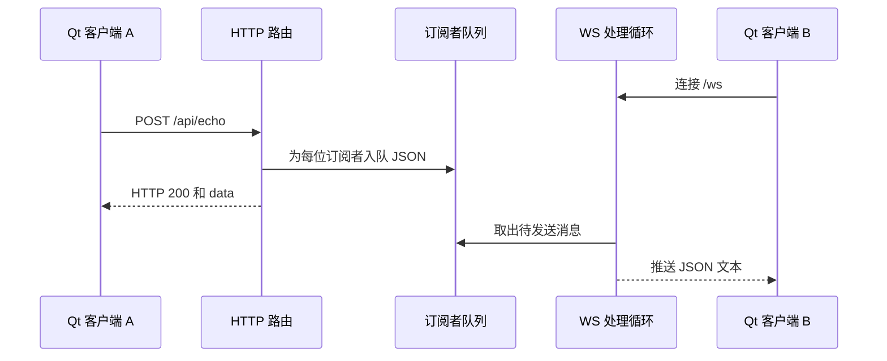

# Qt 轻量 HTTP 与 WebSocket 服务实践——以 qt-http-websocket-demo 为例

配套 Demo 的构建说明和完整代码见 [qt-http-websocket-demo 仓库](https://github.com/soapgu/qt-http-websocket-demo)。

桌面程序有时需要提供一个小型网络入口，让外部工具提交数据，再把变化实时推送给界面。HTTP 适合提交和查询，WebSocket 适合持续接收通知。把两者放在同一个服务端，就能形成“请求修改、订阅变化”的通信流程。

本文以 [qt-http-websocket-demo](https://github.com/soapgu/qt-http-websocket-demo) 的提交 `b14688c` 为参考。当前工程生成两个程序，服务端用 cpp-httplib，客户端用 Qt Quick、Qt Network 和 Qt WebSockets。服务端独立运行，后续可以把核心逻辑封装进 Qt 应用。

阅读时可以对照以下源码，链接固定到本文参考提交。

- HTTP 路由、WebSocket 广播与停止流程见[服务端实现](https://github.com/soapgu/qt-http-websocket-demo/blob/b14688c46cce834f1f4c43d74449f24d5a7b4715/server/src/main.cpp)。
- Qt 请求、订阅和超时处理见[客户端网络控制对象](https://github.com/soapgu/qt-http-websocket-demo/blob/b14688c46cce834f1f4c43d74449f24d5a7b4715/client/src/NetworkController.cpp)。
- 协议联调与进程退出检查见[集成测试脚本](https://github.com/soapgu/qt-http-websocket-demo/blob/b14688c46cce834f1f4c43d74449f24d5a7b4715/tests/integration.py)。

## 工程依赖如何组织

| 目标 | 依赖 | 职责 |
| --- | --- | --- |
| `qt_http_server` | cpp-httplib v0.66.0、nlohmann/json v3.11.3、系统线程库 | HTTP 路由、JSON 解析、WebSocket 广播 |
| `qt_http_client` | Qt 6.8.3 及以上的 Quick、QuickControls2、Network、WebSockets 等模块 | 请求服务、订阅通知、显示状态 |

顶层工程要求 CMake 3.21 和 C++17，通过 `BUILD_SERVER` 与 `BUILD_CLIENT` 开关选择子项目。只构建服务端时，工程无需查找 Qt。

服务端通过 `FetchContent` 下载固定版本归档，并验证 SHA256。项目只取上游头文件，用 INTERFACE 目标把包含路径和线程依赖传给可执行程序。以下是依赖下载完成后的核心配置。

```cmake
find_package(Threads REQUIRED)
add_library(qt_demo_httplib INTERFACE)
target_include_directories(qt_demo_httplib SYSTEM INTERFACE
    "${cpp_httplib_SOURCE_DIR}")
target_link_libraries(qt_demo_httplib INTERFACE Threads::Threads)

add_library(qt_demo_json INTERFACE)
target_include_directories(qt_demo_json SYSTEM INTERFACE
    "${nlohmann_json_SOURCE_DIR}/single_include")

add_executable(qt_http_server src/main.cpp)
target_link_libraries(qt_http_server PRIVATE qt_demo_httplib qt_demo_json)
```

Qt 客户端链接 `Qt6::Network` 和 `Qt6::WebSockets`。双方使用标准协议，客户端和服务端可以分别选择适合自己的实现库。

## 先提供 HTTP 查询与提交入口

服务端创建一个 `httplib::Server`，注册两个 HTTP 路由和一个 WebSocket 路由，最后绑定 `127.0.0.1:8080`。核心状态查询可以写成下面这样。

```cpp
httplib::Server server;
server.Get("/api/status",
    [](const httplib::Request &, httplib::Response &response) {
        response.set_content(
            nlohmann::json{{"status", "ok"}}.dump(), "application/json");
    });
```

`POST /api/echo` 使用 `json::parse(request.body)` 解析输入。合法 JSON 的响应为 `{"data":原始JSON值}`，同时把原始 JSON 的序列化结果交给广播队列。解析失败时设置 HTTP 400，并返回 `{"error":"请求体必须是合法 JSON"}`，广播队列不会收到这次输入。

项目先调用 `bind_to_port()` 检查端口绑定，再调用阻塞的 `listen_after_bind()` 持续监听。绑定失败会输出端口占用提示并退出，方便在 Qt Creator 中发现重复启动问题。

## HTTP 和 WebSocket 共用端口

同一个 `server` 通过 `server.WebSocket("/ws", handler)` 注册 WebSocket 路由。客户端连接 `ws://127.0.0.1:8080/ws`，升级握手成功后保持长连接，HTTP 请求仍访问同一端口的其他路由。



广播和 HTTP 响应分别完成，客户端应先建立订阅再提交。没有订阅者时，HTTP 提交仍然成功。

每条 WebSocket 连接对应一个 `Subscription`，内部有 `std::deque<std::string>` 和溢出标志。HTTP 回调在互斥锁保护下遍历订阅者，把消息放入各自队列。WebSocket 回调从自己的队列取消息，释放锁后调用 `ws.send()`。这样网络发送不会长期占用保护订阅列表的锁。

当某个订阅者已有 100 条待发送消息，新一次提交会将它标记为溢出。该连接随后退出发送循环并关闭，其他订阅者继续工作。这个上限约束的是消息条数。

队列为空时，WebSocket 回调调用 `ws.read()` 检测连接活动。项目将读取等待设为 200 毫秒，返回超时后继续检查队列与停止标志，返回 `Fail` 时退出。收到的客户端消息在这个 Demo 中被忽略，消息广播由 HTTP 提交触发。

cpp-httplib v0.66.0 采用阻塞 I/O，每条 WebSocket 连接使用处理线程，并配有心跳线程，适合连接规模较小的内嵌服务。设置读取超时后要区分 `Timeout` 和 `Fail`，才能保留空闲连接。[固定版本的 WebSocket 文档](https://github.com/yhirose/cpp-httplib/blob/v0.66.0/README-websocket.md)

## Qt 客户端怎样接入

`NetworkController` 持有 `QNetworkAccessManager`、`QWebSocket` 和几个单次定时器。QML 调用控制对象发起请求，控制对象通过属性通知更新界面。

HTTP 部分用 `manager.get()` 查询状态，用 `manager.post()` 提交 JSON，并设置 `ContentTypeHeader`。完成回调读取 HTTP 状态码、响应正文和网络错误，最后调用 `deleteLater()` 释放 reply。项目保留 400 的响应正文，界面可以显示服务端返回的具体原因。5 秒请求定时器到期后调用 `abort()`。

WebSocket 先连接接收信号，再打开地址，核心用法如下。

```cpp
connect(&socket, &QWebSocket::textMessageReceived,
        this, [this](const QString &text) {
            append("接收文本：" + text);
        });
socket.open(QUrl("ws://127.0.0.1:8080/ws"));
```

实际控制对象还校验 URL、处理连接错误与断开事件，并用 5 秒定时器约束连接等待。界面日志最多保存 500 条。更完整的 HTTP 请求生命周期可结合[《Qt 原生 HTTP 实战》](Qt%20原生%20HTTP%20实战——从%20JSON%20请求到图片下载.md)阅读。

手动联调时启动两个客户端窗口，分别连接 WS。任一窗口提交 `{"message":"你好"}` 后，提交窗口收到包含 `data` 的 HTTP 响应，两个订阅窗口都收到原始 JSON。非法 JSON 返回 400，订阅窗口不会产生对应的新广播。

## 从独立服务到 Qt 程序内嵌服务

当前服务端的信号处理函数只设置 `sig_atomic_t` 标志。管理线程每隔约 50 毫秒检查停止请求，设置原子停止标志并调用 `server.stop()`。WebSocket 回调据此退出，清除订阅并关闭连接，主线程等待管理线程结束。编译参数将 WebSocket 关闭握手等待限制为 1 秒。

客户端关闭窗口时取消 HTTP 请求并发起 WS 关闭，最多等待 2 秒，随后强制中止连接并通知程序退出。

后续内嵌到 Qt 程序时，可以将服务对象和启动、停止操作封装到一个库里。阻塞监听放到工作线程，HTTP/WS 回调通过排队信号槽把数据交给 GUI 线程。退出时先请求停止服务，等待监听和连接处理结束，再销毁服务对象及其引用的数据。这部分是集成设计，当前 Demo 保持两个独立可执行程序。

当前实现提供 JSON API 和 WS 通知。若要直接在浏览器打开控制页面，可以进一步增加静态资源路由，并让网页连接同源的 `/ws`。现有服务固定监听回环地址，远端访问需要另外设计监听配置与访问控制。

## 构建、运行和验证

在 Demo 仓库根目录执行，将 Qt 前缀替换为本机 Kit。

```sh
cmake -S . -B build -DCMAKE_PREFIX_PATH="/你的/Qt/安装前缀"
cmake --build build --config Debug
./build/bin/qt_http_server
# 另开终端
./build/bin/qt_http_client
```

只运行 HTTP 和 WS 服务时，可以单独构建服务端。

```sh
cmake -S . -B build-server -DBUILD_SERVER=ON -DBUILD_CLIENT=OFF
cmake --build build-server --config Debug
./build-server/bin/qt_http_server
```

服务启动后，用终端检查两个 HTTP 路由。

```sh
curl http://127.0.0.1:8080/api/status
curl -H 'Content-Type: application/json' \
    -d '{"message":"你好"}' http://127.0.0.1:8080/api/echo
```

仓库的集成脚本使用 Python 标准库，自己启动并清理服务端进程。先停止手动运行的服务端，释放 8080 端口，再执行以下命令。

```sh
python3 tests/integration.py --server "$PWD/build/bin/qt_http_server"
```

脚本覆盖无订阅者提交、多订阅者广播、非法 JSON、WS 消息不回显、重连、信号停止和端口重新绑定。客户端还有独立的 smoke 检查入口，运行方式见 Demo README。自动检查和窗口交互验收分别验证协议行为与界面使用流程。

本次写作核对了上述参考提交的源码。尝试运行集成检查时，本机 8080 端口被 nginx 占用，已有构建产物仍为早期骨架，因此本次未完成端到端验证。
